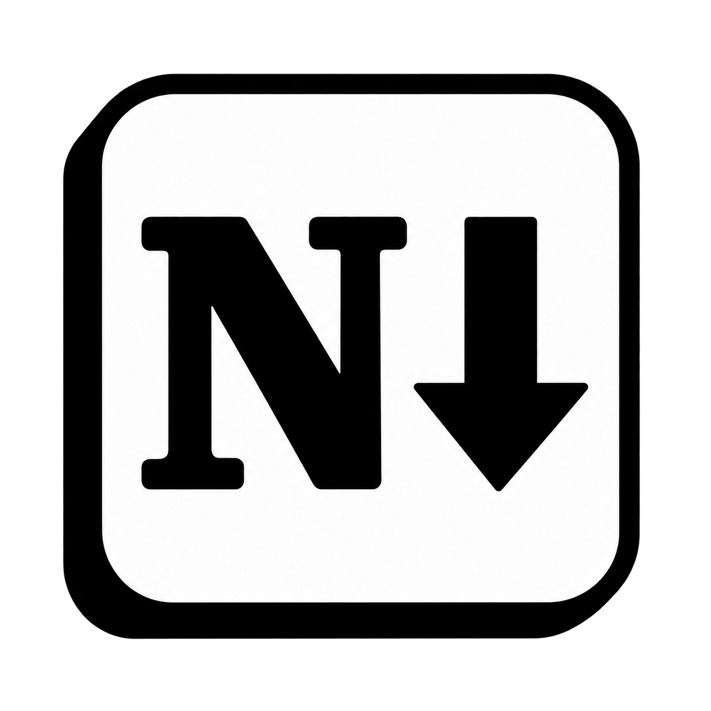

<p align="center">
  
</p>

<h1 align="center">Notdown</h1>

<p align="center">Write with blocks. Keep your notes in Markdown.</p>

<p align="center">
  <strong>English</strong> · <a href="README.zh-CN.md">简体中文</a>
</p>

<p align="center">
  <a href="#features">Features</a> ·
  <a href="#quick-start">Quick start</a> ·
  <a href="#current-status">Current status</a> ·
  <a href="#documentation">Documentation</a>
</p>

Notdown is a local note-taking app that combines block editing with Markdown files. Write visually, work directly in source, or keep both views side by side. Organize notes into pages, connect them with links, and keep the files on your own computer.

## Features

- **Write your way.** Keep pages in tabs on desktop or in your browser. Use Page, Source and Split views, slash commands, inline formatting, and blocks you can select and move.
- **Connect your notes.** Nested pages, search, favorites, backlinks, an outline, a mind map and a page graph.
- **Work with rich content.** Images and media, tables, callouts, equations, Mermaid diagrams, footnotes and citations, with selectable Markdown dialects. Browse and reuse local files in the [attachment library](docs/features/MEDIA-AND-EMBEDS.md).
- **Organize structured information.** Full-page and inline databases on desktop and Android, with table, list, gallery, board and calendar views, typed properties and records backed by Markdown pages.
- **Bring existing notes.** Preview and import Markdown folders or Notion pages and databases as local copies.
- **Keep control of your files.** Local Markdown storage, revision-checked saves, recoverable history and conflict copies, with optional local Git history on desktop.

Optional [AI blocks](docs/features/AI-BLOCKS.md), [meeting notes](docs/features/MEETING-NOTES.md) and [executable notebooks](docs/features/QUARTO.md) add generation, transcription and computation after you configure the relevant services or runtimes.

## Quick start

To run from source, install **Node.js 24 and npm**, then run this in the repository directory:

```sh
npm ci
```

### Windows desktop

```sh
npm run desktop
```

Choose **Create new vault** for an empty folder or **Open existing vault** for a Notdown vault, then click **New page** to start writing.

Closing the desktop window keeps the app in the system tray. Use the tray to reopen it or quit.

To build a Windows x64 installer, run `npm run desktop:dist`; the output is in `.run/desktop-release/`. Installed users do not need Node.js. See the [desktop guide](docs/features/DESKTOP-AND-IMPORT.md) for packaging and vault details.

### In your browser

```sh
npm run dev
```

Open [localhost:4317](http://127.0.0.1:4317). Notes live in a separate vault folder; keep the terminal running while you use the app. On Windows, after installing dependencies, you can also double-click [start.cmd](start.cmd).

Create or switch vaults from the sidebar heading or Workspace settings. Custom paths, service restarts and production builds are covered in the [running and development guide](docs/architecture/DEVELOPMENT.md).

### Android preview

The early Android app connects to an existing cloud notebook from your computer. Configure sync on first launch; after the initial download, notes and attachments remain available offline. See the [Android guide](docs/features/ANDROID.md) for installation and limitations.

### Bring your notes

Open **Import** in the sidebar and choose **Import Markdown folder** or **Import from Notion API**. Review the preview, then choose **Import copies**. Imports preserve their originals; Notion import is one-way and requires a Notion integration with access to the selected content.

## Your files

Each vault has its own folder, containing `pages/*.md`, `assets/`, and `metadata.json` for shared page properties. Document YAML or Pandoc title blocks override those shared defaults. Source view shows the complete Markdown file.

Use one running service per vault. Back up the whole vault folder to include attachments and metadata. For storage, conflict recovery and explicit migrations, see [vault metadata](docs/features/VAULT-METADATA.md).

## Current status

Notdown is an actively developed local application prototype. The interface is currently English only.

- **Device sync:** experimental foreground sync supports Supabase or WebDAV on desktop and Android. There is no bundled cloud service, end-to-end encryption, or real-time collaboration. See [setup and limits](docs/features/CLOUD-SYNC.md).
- **Format support:** compatibility varies by dialect; complex or unsupported content may need source editing.
- **Databases and imports:** databases support five local layouts; imported formulas and rollups are read-only snapshots. Notion imports save accessible attachments locally; failed downloads and unsupported cloud features remain incomplete.
- **Platforms:** the Windows build is unsigned; Android is an early development build requiring device validation. Automatic updates and macOS/Linux installers are not available yet.

## Documentation

Detailed guides are currently mostly in Chinese.

| I want to… | Read |
| --- | --- |
| Learn the editor and navigation | [Writing and navigation](docs/features/WRITING-AND-NAVIGATION.md) |
| Add files, media or embeds | [Media and embeds](docs/features/MEDIA-AND-EMBEDS.md) |
| Import existing notes | [Markdown folders](docs/features/DESKTOP-AND-IMPORT.md) · [Notion](docs/features/NOTION-IMPORT.md) |
| Work with structured data | [Databases](docs/features/DATABASES.md) |
| Understand Markdown compatibility | [Supported content](docs/reference/NOTDOWN-SUPERSET.md) · [Format contract](docs/FORMAT.md) |
| Find all guides and references | [Documentation index](docs/README.md) |

## Development

Start with the [development guide](docs/architecture/DEVELOPMENT.md), [repository layout](docs/architecture/REPOSITORY.md) and [contributor instructions](AGENTS.md). The app uses TypeScript, Vite, a local Node service, ProseMirror and CodeMirror.

Run `npm test` and `npm run build` to validate changes; editor interaction changes also require `npm run test:e2e`. Tests use temporary vaults.

## Acknowledgments

SiYuan informed the local storage design; AFFiNE and AppFlowy informed block interactions. Notdown is an independent implementation.

Thanks to ProseMirror, CodeMirror, markdown-it, Lucide, KaTeX, Mermaid and the other dependencies that make the project possible. Bundled fonts retain their license notices: [Noto](src/assets/fonts/LICENSE-Noto.txt) and [OpenMoji](src/assets/fonts/LICENSE-OpenMoji.txt).
