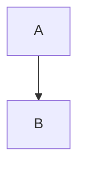

# gfm 官方语法测试文档

每个 CASE 独立执行；完整文件另作整篇转换。行范围以 cases.json 为准。
元数据文首、未闭合围栏、引用定义等边界必须使用独立片段结果，不能以拼接结果替代。


<!-- CASE paragraphs -->

第一段 line one
line two

第二段。


<!-- CASE hard-break-spaces -->

alpha  
beta


<!-- CASE headings-atx -->

# One

## Two ##

### Three #####

#### Four

##### Five

###### Six


<!-- CASE headings-setext -->

Title
=====

Subtitle
--------


<!-- CASE headings-space-boundary -->

#nospace

####### seven


<!-- CASE heading-interruption -->

paragraph
# heading


<!-- CASE quote-lazy -->

> first line
lazy continuation
> last line


<!-- CASE quote-nesting -->

> outer
>
> > inner
>
> tail


<!-- CASE quote-blocks -->

> ## heading
>
> - item
>
>     code


<!-- CASE bullet-markers -->

* alpha
* beta

+ gamma
+ delta

- epsilon
- zeta


<!-- CASE ordered-start -->

3. third
8. fourth
1. fifth


<!-- CASE list-tight-loose -->

- tight one
- tight two

1. loose one

2. loose two


<!-- CASE list-paragraphs -->

- first

    second paragraph

    > quote

        code


<!-- CASE list-nesting -->

1. outer
    - middle
        1. inner
2. next


<!-- CASE list-interruption -->

paragraph
- candidate

1986. historical year


<!-- CASE code-indentation -->

    <sample>& literal *text*

    next line


<!-- CASE code-tab -->

	alpha	beta


<!-- CASE rules -->

***

- - -

___

* * * *


<!-- CASE inline-links -->

[label](https://example.com/a?x=1&y=2 "a title") [relative](./next.md) [fragment](#anchor)


<!-- CASE reference-links -->

[full][Ref] [ref][] [Ref]

[ref]: https://example.com "reference title"


<!-- CASE reference-spacing -->

[visible] [case fold]

[CASE FOLD]: <https://example.com>
    "continued title"


<!-- CASE reference-duplicate -->

[target]

[target]: /first
[target]: /second


<!-- CASE emphasis -->

*italic* _italic_ **bold** __bold__ ***both*** a*b*c a_b_c


<!-- CASE emphasis-boundaries -->

* spaced * ** spaced ** foo__bar__baz **outer *inner* tail**


<!-- CASE code-spans -->

`<b>& *literal*</b>` ``backtick ` inside`` `` padded ``


<!-- CASE images -->


inline ![reference][pic] tail

[pic]: /other.png "reference title"


<!-- CASE autolinks -->

<https://example.com/a?x=1&y=2> <reader@example.com>


<!-- CASE escaping -->

\*literal\* \_literal\_ \`code\` \#heading \[link] \! \\


<!-- CASE entities -->

AT&T 4 < 5 &copy; &amp; &#35; &#x41; &not-an-entity;


<!-- CASE html-inline -->

before <span title="t">*em*</span> <u>under</u> after


<!-- CASE html-block -->

before

<div>
*literal inside block*
</div>

after


<!-- CASE html-comment -->

before

<!-- hidden
line -->

after


<!-- CASE escaped-list -->

1\. plain

\- plain


<!-- CASE unicode -->

中文 **加粗** Ελληνικά café 😀


<!-- CASE table-align -->

| left | center | right |
| :--- | :---: | ---: |
| *a* | **b** | `c` |


<!-- CASE table-pipes -->

a | b
--- | ---
\| | `x\|y`
short
extra | cell | discarded


<!-- CASE table-negative -->

a | b
---
x | y


<!-- CASE table-empty-body -->

| a | b |
| --- | --- |


<!-- CASE table-block-boundary -->

| a | b |
| --- | --- |
| x | y |

> next block


<!-- CASE task-items -->

- [ ] todo
- [x] done
- [X] upper
- [a] literal
  - [ ] nested


<!-- CASE task-not-list -->

[x] plain paragraph

- [x]no following space


<!-- CASE strikethrough -->

~~deleted~~ ~single~ ~~**bold**~~

~~~triple~~~


<!-- CASE bare-autolinks -->

www.example.com https://example.com/a_(b). user@example.com foo+bar@example.org


<!-- CASE autolink-boundary -->

abcwww.example.com <https://example.com> `https://example.com` https://example.com/a&amp;


<!-- CASE tagfilter -->

<script>literal</script>

<iframe src="https://example.com"></iframe>

<xmp>raw</xmp>


<!-- CASE gfm-example-1 -->

	foo	baz		bim


<!-- CASE gfm-example-2 -->

  	foo	baz		bim


<!-- CASE gfm-example-3 -->

    a	a
    ὐ	a


<!-- CASE gfm-example-4 -->

  - foo

	bar


<!-- CASE gfm-example-5 -->

- foo

		bar


<!-- CASE gfm-example-6 -->

>		foo


<!-- CASE gfm-example-7 -->

-		foo


<!-- CASE gfm-example-8 -->

    foo
	bar


<!-- CASE gfm-example-9 -->

 - foo
   - bar
	 - baz


<!-- CASE gfm-example-10 -->

#	Foo


<!-- CASE gfm-example-11 -->

*	*	*	


<!-- CASE gfm-example-12 -->

- `one
- two`


<!-- CASE gfm-example-13 -->

***
---
___


<!-- CASE gfm-example-14 -->

+++


<!-- CASE gfm-example-15 -->

===


<!-- CASE gfm-example-16 -->

--
**
__


<!-- CASE gfm-example-17 -->

 ***
  ***
   ***


<!-- CASE gfm-example-18 -->

    ***


<!-- CASE gfm-example-19 -->

Foo
    ***


<!-- CASE gfm-example-20 -->

_____________________________________


<!-- CASE gfm-example-21 -->

 - - -


<!-- CASE gfm-example-22 -->

 **  * ** * ** * **


<!-- CASE gfm-example-23 -->

-     -      -      -


<!-- CASE gfm-example-24 -->

- - - -    


<!-- CASE gfm-example-25 -->

_ _ _ _ a

a------

---a---


<!-- CASE gfm-example-26 -->

 *-*


<!-- CASE gfm-example-27 -->

- foo
***
- bar


<!-- CASE gfm-example-28 -->

Foo
***
bar


<!-- CASE gfm-example-29 -->

Foo
---
bar


<!-- CASE gfm-example-30 -->

* Foo
* * *
* Bar


<!-- CASE gfm-example-31 -->

- Foo
- * * *


<!-- CASE gfm-example-32 -->

# foo
## foo
### foo
#### foo
##### foo
###### foo


<!-- CASE gfm-example-33 -->

####### foo


<!-- CASE gfm-example-34 -->

#5 bolt

#hashtag


<!-- CASE gfm-example-35 -->

\## foo


<!-- CASE gfm-example-36 -->

# foo *bar* \*baz\*


<!-- CASE gfm-example-37 -->

#                  foo                     


<!-- CASE gfm-example-38 -->

 ### foo
  ## foo
   # foo


<!-- CASE gfm-example-39 -->

    # foo


<!-- CASE gfm-example-40 -->

foo
    # bar


<!-- CASE gfm-example-41 -->

## foo ##
  ###   bar    ###


<!-- CASE gfm-example-42 -->

# foo ##################################
##### foo ##


<!-- CASE gfm-example-43 -->

### foo ###     


<!-- CASE gfm-example-44 -->

### foo ### b


<!-- CASE gfm-example-45 -->

# foo#


<!-- CASE gfm-example-46 -->

### foo \###
## foo #\##
# foo \#


<!-- CASE gfm-example-47 -->

****
## foo
****


<!-- CASE gfm-example-48 -->

Foo bar
# baz
Bar foo


<!-- CASE gfm-example-49 -->

## 
#
### ###


<!-- CASE gfm-example-50 -->

Foo *bar*
=========

Foo *bar*
---------


<!-- CASE gfm-example-51 -->

Foo *bar
baz*
====


<!-- CASE gfm-example-52 -->

  Foo *bar
baz*	
====


<!-- CASE gfm-example-53 -->

Foo
-------------------------

Foo
=


<!-- CASE gfm-example-54 -->

   Foo
---

  Foo
-----

  Foo
  ===


<!-- CASE gfm-example-55 -->

    Foo
    ---

    Foo
---


<!-- CASE gfm-example-56 -->

Foo
   ----      


<!-- CASE gfm-example-57 -->

Foo
    ---


<!-- CASE gfm-example-58 -->

Foo
= =

Foo
--- -


<!-- CASE gfm-example-59 -->

Foo  
-----


<!-- CASE gfm-example-60 -->

Foo\
----


<!-- CASE gfm-example-61 -->

`Foo
----
`

<a title="a lot
---
of dashes"/>


<!-- CASE gfm-example-62 -->

> Foo
---


<!-- CASE gfm-example-63 -->

> foo
bar
===


<!-- CASE gfm-example-64 -->

- Foo
---


<!-- CASE gfm-example-65 -->

Foo
Bar
---


<!-- CASE gfm-example-66 -->

---
Foo
---
Bar
---
Baz


<!-- CASE gfm-example-67 -->


====


<!-- CASE gfm-example-68 -->

---
---


<!-- CASE gfm-example-69 -->

- foo
-----


<!-- CASE gfm-example-70 -->

    foo
---


<!-- CASE gfm-example-71 -->

> foo
-----


<!-- CASE gfm-example-72 -->

\> foo
------


<!-- CASE gfm-example-73 -->

Foo

bar
---
baz


<!-- CASE gfm-example-74 -->

Foo
bar

---

baz


<!-- CASE gfm-example-75 -->

Foo
bar
* * *
baz


<!-- CASE gfm-example-76 -->

Foo
bar
\---
baz


<!-- CASE gfm-example-77 -->

    a simple
      indented code block


<!-- CASE gfm-example-78 -->

  - foo

    bar


<!-- CASE gfm-example-79 -->

1.  foo

    - bar


<!-- CASE gfm-example-80 -->

    <a/>
    *hi*

    - one


<!-- CASE gfm-example-81 -->

    chunk1

    chunk2
  
 
 
    chunk3


<!-- CASE gfm-example-82 -->

    chunk1
      
      chunk2


<!-- CASE gfm-example-83 -->

Foo
    bar


<!-- CASE gfm-example-84 -->

    foo
bar


<!-- CASE gfm-example-85 -->

# Heading
    foo
Heading
------
    foo
----


<!-- CASE gfm-example-86 -->

        foo
    bar


<!-- CASE gfm-example-87 -->


    
    foo
    


<!-- CASE gfm-example-88 -->

    foo  


<!-- CASE gfm-example-89 -->

```
<
 >
```


<!-- CASE gfm-example-90 -->

~~~
<
 >
~~~


<!-- CASE gfm-example-91 -->

``
foo
``


<!-- CASE gfm-example-92 -->

```
aaa
~~~
```


<!-- CASE gfm-example-93 -->

~~~
aaa
```
~~~


<!-- CASE gfm-example-94 -->

````
aaa
```
``````


<!-- CASE gfm-example-95 -->

~~~~
aaa
~~~
~~~~


<!-- CASE gfm-example-96 -->

```


<!-- CASE gfm-example-97 -->

`````

```
aaa


<!-- CASE gfm-example-98 -->

> ```
> aaa

bbb


<!-- CASE gfm-example-99 -->

```

  
```


<!-- CASE gfm-example-100 -->

```
```


<!-- CASE gfm-example-101 -->

 ```
 aaa
aaa
```


<!-- CASE gfm-example-102 -->

  ```
aaa
  aaa
aaa
  ```


<!-- CASE gfm-example-103 -->

   ```
   aaa
    aaa
  aaa
   ```


<!-- CASE gfm-example-104 -->

    ```
    aaa
    ```


<!-- CASE gfm-example-105 -->

```
aaa
  ```


<!-- CASE gfm-example-106 -->

   ```
aaa
  ```


<!-- CASE gfm-example-107 -->

```
aaa
    ```


<!-- CASE gfm-example-108 -->

``` ```
aaa


<!-- CASE gfm-example-109 -->

~~~~~~
aaa
~~~ ~~


<!-- CASE gfm-example-110 -->

foo
```
bar
```
baz


<!-- CASE gfm-example-111 -->

foo
---
~~~
bar
~~~
# baz


<!-- CASE gfm-example-112 -->

```ruby
def foo(x)
  return 3
end
```


<!-- CASE gfm-example-113 -->

~~~~    ruby startline=3 $%@#$
def foo(x)
  return 3
end
~~~~~~~


<!-- CASE gfm-example-114 -->

````;
````


<!-- CASE gfm-example-115 -->

``` aa ```
foo


<!-- CASE gfm-example-116 -->

~~~ aa ``` ~~~
foo
~~~


<!-- CASE gfm-example-117 -->

```
``` aaa
```


<!-- CASE gfm-example-118 -->

<table><tr><td>
<pre>
**Hello**,

_world_.
</pre>
</td></tr></table>


<!-- CASE gfm-example-119 -->

<table>
  <tr>
    <td>
           hi
    </td>
  </tr>
</table>

okay.


<!-- CASE gfm-example-120 -->

 <div>
  *hello*
         <foo><a>


<!-- CASE gfm-example-121 -->

</div>
*foo*


<!-- CASE gfm-example-122 -->

<DIV CLASS="foo">

*Markdown*

</DIV>


<!-- CASE gfm-example-123 -->

<div id="foo"
  class="bar">
</div>


<!-- CASE gfm-example-124 -->

<div id="foo" class="bar
  baz">
</div>


<!-- CASE gfm-example-125 -->

<div>
*foo*

*bar*


<!-- CASE gfm-example-126 -->

<div id="foo"
*hi*


<!-- CASE gfm-example-127 -->

<div class
foo


<!-- CASE gfm-example-128 -->

<div *???-&&&-<---
*foo*


<!-- CASE gfm-example-129 -->

<div><a href="bar">*foo*</a></div>


<!-- CASE gfm-example-130 -->

<table><tr><td>
foo
</td></tr></table>


<!-- CASE gfm-example-131 -->

<div></div>
``` c
int x = 33;
```


<!-- CASE gfm-example-132 -->

<a href="foo">
*bar*
</a>


<!-- CASE gfm-example-133 -->

<Warning>
*bar*
</Warning>


<!-- CASE gfm-example-134 -->

<i class="foo">
*bar*
</i>


<!-- CASE gfm-example-135 -->

</ins>
*bar*


<!-- CASE gfm-example-136 -->

<del>
*foo*
</del>


<!-- CASE gfm-example-137 -->

<del>

*foo*

</del>


<!-- CASE gfm-example-138 -->

<del>*foo*</del>


<!-- CASE gfm-example-139 -->

<pre language="haskell"><code>
import Text.HTML.TagSoup

main :: IO ()
main = print $ parseTags tags
</code></pre>
okay


<!-- CASE gfm-example-140 -->

<script type="text/javascript">
// JavaScript example

document.getElementById("demo").innerHTML = "Hello JavaScript!";
</script>
okay


<!-- CASE gfm-example-141 -->

<style
  type="text/css">
h1 {color:red;}

p {color:blue;}
</style>
okay


<!-- CASE gfm-example-142 -->

<style
  type="text/css">

foo


<!-- CASE gfm-example-143 -->

> <div>
> foo

bar


<!-- CASE gfm-example-144 -->

- <div>
- foo


<!-- CASE gfm-example-145 -->

<style>p{color:red;}</style>
*foo*


<!-- CASE gfm-example-146 -->

<!-- foo -->*bar*
*baz*


<!-- CASE gfm-example-147 -->

<script>
foo
</script>1. *bar*


<!-- CASE gfm-example-148 -->

<!-- Foo

bar
   baz -->
okay


<!-- CASE gfm-example-149 -->

<?php

  echo '>';

?>
okay


<!-- CASE gfm-example-150 -->

<!DOCTYPE html>


<!-- CASE gfm-example-151 -->

<![CDATA[
function matchwo(a,b)
{
  if (a < b && a < 0) then {
    return 1;

  } else {

    return 0;
  }
}
]]>
okay


<!-- CASE gfm-example-152 -->

  <!-- foo -->

    <!-- foo -->


<!-- CASE gfm-example-153 -->

  <div>

    <div>


<!-- CASE gfm-example-154 -->

Foo
<div>
bar
</div>


<!-- CASE gfm-example-155 -->

<div>
bar
</div>
*foo*


<!-- CASE gfm-example-156 -->

Foo
<a href="bar">
baz


<!-- CASE gfm-example-157 -->

<div>

*Emphasized* text.

</div>


<!-- CASE gfm-example-158 -->

<div>
*Emphasized* text.
</div>


<!-- CASE gfm-example-159 -->

<table>

<tr>

<td>
Hi
</td>

</tr>

</table>


<!-- CASE gfm-example-160 -->

<table>

  <tr>

    <td>
      Hi
    </td>

  </tr>

</table>


<!-- CASE gfm-example-161 -->

[foo]: /url "title"

[foo]


<!-- CASE gfm-example-162 -->

   [foo]: 
      /url  
           'the title'  

[foo]


<!-- CASE gfm-example-163 -->

[Foo*bar\]]:my_(url) 'title (with parens)'

[Foo*bar\]]


<!-- CASE gfm-example-164 -->

[Foo bar]:
<my url>
'title'

[Foo bar]


<!-- CASE gfm-example-165 -->

[foo]: /url '
title
line1
line2
'

[foo]


<!-- CASE gfm-example-166 -->

[foo]: /url 'title

with blank line'

[foo]


<!-- CASE gfm-example-167 -->

[foo]:
/url

[foo]


<!-- CASE gfm-example-168 -->

[foo]:

[foo]


<!-- CASE gfm-example-169 -->

[foo]: <>

[foo]


<!-- CASE gfm-example-170 -->

[foo]: <bar>(baz)

[foo]


<!-- CASE gfm-example-171 -->

[foo]: /url\bar\*baz "foo\"bar\baz"

[foo]


<!-- CASE gfm-example-172 -->

[foo]

[foo]: url


<!-- CASE gfm-example-173 -->

[foo]

[foo]: first
[foo]: second


<!-- CASE gfm-example-174 -->

[FOO]: /url

[Foo]


<!-- CASE gfm-example-175 -->

[ΑΓΩ]: /φου

[αγω]


<!-- CASE gfm-example-176 -->

[foo]: /url


<!-- CASE gfm-example-177 -->

[
foo
]: /url
bar


<!-- CASE gfm-example-178 -->

[foo]: /url "title" ok


<!-- CASE gfm-example-179 -->

[foo]: /url
"title" ok


<!-- CASE gfm-example-180 -->

    [foo]: /url "title"

[foo]


<!-- CASE gfm-example-181 -->

```
[foo]: /url
```

[foo]


<!-- CASE gfm-example-182 -->

Foo
[bar]: /baz

[bar]


<!-- CASE gfm-example-183 -->

# [Foo]
[foo]: /url
> bar


<!-- CASE gfm-example-184 -->

[foo]: /url
bar
===
[foo]


<!-- CASE gfm-example-185 -->

[foo]: /url
===
[foo]


<!-- CASE gfm-example-186 -->

[foo]: /foo-url "foo"
[bar]: /bar-url
  "bar"
[baz]: /baz-url

[foo],
[bar],
[baz]


<!-- CASE gfm-example-187 -->

[foo]

> [foo]: /url


<!-- CASE gfm-example-188 -->

[foo]: /url


<!-- CASE gfm-example-189 -->

aaa

bbb


<!-- CASE gfm-example-190 -->

aaa
bbb

ccc
ddd


<!-- CASE gfm-example-191 -->

aaa


bbb


<!-- CASE gfm-example-192 -->

  aaa
 bbb


<!-- CASE gfm-example-193 -->

aaa
             bbb
                                       ccc


<!-- CASE gfm-example-194 -->

   aaa
bbb


<!-- CASE gfm-example-195 -->

    aaa
bbb


<!-- CASE gfm-example-196 -->

aaa     
bbb     


<!-- CASE gfm-example-197 -->

  

aaa
  

# aaa

  


<!-- CASE gfm-example-198 -->

| foo | bar |
| --- | --- |
| baz | bim |


<!-- CASE gfm-example-199 -->

| abc | defghi |
:-: | -----------:
bar | baz


<!-- CASE gfm-example-200 -->

| f\|oo  |
| ------ |
| b `\|` az |
| b **\|** im |


<!-- CASE gfm-example-201 -->

| abc | def |
| --- | --- |
| bar | baz |
> bar


<!-- CASE gfm-example-202 -->

| abc | def |
| --- | --- |
| bar | baz |
bar

bar


<!-- CASE gfm-example-203 -->

| abc | def |
| --- |
| bar |


<!-- CASE gfm-example-204 -->

| abc | def |
| --- | --- |
| bar |
| bar | baz | boo |


<!-- CASE gfm-example-205 -->

| abc | def |
| --- | --- |


<!-- CASE gfm-example-206 -->

> # Foo
> bar
> baz


<!-- CASE gfm-example-207 -->

># Foo
>bar
> baz


<!-- CASE gfm-example-208 -->

   > # Foo
   > bar
 > baz


<!-- CASE gfm-example-209 -->

    > # Foo
    > bar
    > baz


<!-- CASE gfm-example-210 -->

> # Foo
> bar
baz


<!-- CASE gfm-example-211 -->

> bar
baz
> foo


<!-- CASE gfm-example-212 -->

> foo
---


<!-- CASE gfm-example-213 -->

> - foo
- bar


<!-- CASE gfm-example-214 -->

>     foo
    bar


<!-- CASE gfm-example-215 -->

> ```
foo
```


<!-- CASE gfm-example-216 -->

> foo
    - bar


<!-- CASE gfm-example-217 -->

>


<!-- CASE gfm-example-218 -->

>
>  
> 


<!-- CASE gfm-example-219 -->

>
> foo
>  


<!-- CASE gfm-example-220 -->

> foo

> bar


<!-- CASE gfm-example-221 -->

> foo
> bar


<!-- CASE gfm-example-222 -->

> foo
>
> bar


<!-- CASE gfm-example-223 -->

foo
> bar


<!-- CASE gfm-example-224 -->

> aaa
***
> bbb


<!-- CASE gfm-example-225 -->

> bar
baz


<!-- CASE gfm-example-226 -->

> bar

baz


<!-- CASE gfm-example-227 -->

> bar
>
baz


<!-- CASE gfm-example-228 -->

> > > foo
bar


<!-- CASE gfm-example-229 -->

>>> foo
> bar
>>baz


<!-- CASE gfm-example-230 -->

>     code

>    not code


<!-- CASE gfm-example-231 -->

A paragraph
with two lines.

    indented code

> A block quote.


<!-- CASE gfm-example-232 -->

1.  A paragraph
    with two lines.

        indented code

    > A block quote.


<!-- CASE gfm-example-233 -->

- one

 two


<!-- CASE gfm-example-234 -->

- one

  two


<!-- CASE gfm-example-235 -->

 -    one

     two


<!-- CASE gfm-example-236 -->

 -    one

      two


<!-- CASE gfm-example-237 -->

   > > 1.  one
>>
>>     two


<!-- CASE gfm-example-238 -->

>>- one
>>
  >  > two


<!-- CASE gfm-example-239 -->

-one

2.two


<!-- CASE gfm-example-240 -->

- foo


  bar


<!-- CASE gfm-example-241 -->

1.  foo

    ```
    bar
    ```

    baz

    > bam


<!-- CASE gfm-example-242 -->

- Foo

      bar


      baz


<!-- CASE gfm-example-243 -->

123456789. ok


<!-- CASE gfm-example-244 -->

1234567890. not ok


<!-- CASE gfm-example-245 -->

0. ok


<!-- CASE gfm-example-246 -->

003. ok


<!-- CASE gfm-example-247 -->

-1. not ok


<!-- CASE gfm-example-248 -->

- foo

      bar


<!-- CASE gfm-example-249 -->

  10.  foo

           bar


<!-- CASE gfm-example-250 -->

    indented code

paragraph

    more code


<!-- CASE gfm-example-251 -->

1.     indented code

   paragraph

       more code


<!-- CASE gfm-example-252 -->

1.      indented code

   paragraph

       more code


<!-- CASE gfm-example-253 -->

   foo

bar


<!-- CASE gfm-example-254 -->

-    foo

  bar


<!-- CASE gfm-example-255 -->

-  foo

   bar


<!-- CASE gfm-example-256 -->

-
  foo
-
  ```
  bar
  ```
-
      baz


<!-- CASE gfm-example-257 -->

-   
  foo


<!-- CASE gfm-example-258 -->

-

  foo


<!-- CASE gfm-example-259 -->

- foo
-
- bar


<!-- CASE gfm-example-260 -->

- foo
-   
- bar


<!-- CASE gfm-example-261 -->

1. foo
2.
3. bar


<!-- CASE gfm-example-262 -->

*


<!-- CASE gfm-example-263 -->

foo
*

foo
1.


<!-- CASE gfm-example-264 -->

 1.  A paragraph
     with two lines.

         indented code

     > A block quote.


<!-- CASE gfm-example-265 -->

  1.  A paragraph
      with two lines.

          indented code

      > A block quote.


<!-- CASE gfm-example-266 -->

   1.  A paragraph
       with two lines.

           indented code

       > A block quote.


<!-- CASE gfm-example-267 -->

    1.  A paragraph
        with two lines.

            indented code

        > A block quote.


<!-- CASE gfm-example-268 -->

  1.  A paragraph
with two lines.

          indented code

      > A block quote.


<!-- CASE gfm-example-269 -->

  1.  A paragraph
    with two lines.


<!-- CASE gfm-example-270 -->

> 1. > Blockquote
continued here.


<!-- CASE gfm-example-271 -->

> 1. > Blockquote
> continued here.


<!-- CASE gfm-example-272 -->

- foo
  - bar
    - baz
      - boo


<!-- CASE gfm-example-273 -->

- foo
 - bar
  - baz
   - boo


<!-- CASE gfm-example-274 -->

10) foo
    - bar


<!-- CASE gfm-example-275 -->

10) foo
   - bar


<!-- CASE gfm-example-276 -->

- - foo


<!-- CASE gfm-example-277 -->

1. - 2. foo


<!-- CASE gfm-example-278 -->

- # Foo
- Bar
  ---
  baz


<!-- CASE gfm-example-279 -->

- [ ] foo
- [x] bar


<!-- CASE gfm-example-280 -->

- [x] foo
  - [ ] bar
  - [x] baz
- [ ] bim


<!-- CASE gfm-example-281 -->

- foo
- bar
+ baz


<!-- CASE gfm-example-282 -->

1. foo
2. bar
3) baz


<!-- CASE gfm-example-283 -->

Foo
- bar
- baz


<!-- CASE gfm-example-284 -->

The number of windows in my house is
14.  The number of doors is 6.


<!-- CASE gfm-example-285 -->

The number of windows in my house is
1.  The number of doors is 6.


<!-- CASE gfm-example-286 -->

- foo

- bar


- baz


<!-- CASE gfm-example-287 -->

- foo
  - bar
    - baz


      bim


<!-- CASE gfm-example-288 -->

- foo
- bar

<!-- -->

- baz
- bim


<!-- CASE gfm-example-289 -->

-   foo

    notcode

-   foo

<!-- -->

    code


<!-- CASE gfm-example-290 -->

- a
 - b
  - c
   - d
  - e
 - f
- g


<!-- CASE gfm-example-291 -->

1. a

  2. b

   3. c


<!-- CASE gfm-example-292 -->

- a
 - b
  - c
   - d
    - e


<!-- CASE gfm-example-293 -->

1. a

  2. b

    3. c


<!-- CASE gfm-example-294 -->

- a
- b

- c


<!-- CASE gfm-example-295 -->

* a
*

* c


<!-- CASE gfm-example-296 -->

- a
- b

  c
- d


<!-- CASE gfm-example-297 -->

- a
- b

  [ref]: /url
- d


<!-- CASE gfm-example-298 -->

- a
- ```
  b


  ```
- c


<!-- CASE gfm-example-299 -->

- a
  - b

    c
- d


<!-- CASE gfm-example-300 -->

* a
  > b
  >
* c


<!-- CASE gfm-example-301 -->

- a
  > b
  ```
  c
  ```
- d


<!-- CASE gfm-example-302 -->

- a


<!-- CASE gfm-example-303 -->

- a
  - b


<!-- CASE gfm-example-304 -->

1. ```
   foo
   ```

   bar


<!-- CASE gfm-example-305 -->

* foo
  * bar

  baz


<!-- CASE gfm-example-306 -->

- a
  - b
  - c

- d
  - e
  - f


<!-- CASE gfm-example-307 -->

`hi`lo`


<!-- CASE gfm-example-308 -->

\!\"\#\$\%\&\'\(\)\*\+\,\-\.\/\:\;\<\=\>\?\@\[\\\]\^\_\`\{\|\}\~


<!-- CASE gfm-example-309 -->

\	\A\a\ \3\φ\«


<!-- CASE gfm-example-310 -->

\*not emphasized*
\<br/> not a tag
\[not a link](/foo)
\`not code`
1\. not a list
\* not a list
\# not a heading
\[foo]: /url "not a reference"
\&ouml; not a character entity


<!-- CASE gfm-example-311 -->

\\*emphasis*


<!-- CASE gfm-example-312 -->

foo\
bar


<!-- CASE gfm-example-313 -->

`` \[\` ``


<!-- CASE gfm-example-314 -->

    \[\]


<!-- CASE gfm-example-315 -->

~~~
\[\]
~~~


<!-- CASE gfm-example-316 -->

<http://example.com?find=\*>


<!-- CASE gfm-example-317 -->

<a href="/bar\/)">


<!-- CASE gfm-example-318 -->

[foo](/bar\* "ti\*tle")


<!-- CASE gfm-example-319 -->

[foo]

[foo]: /bar\* "ti\*tle"


<!-- CASE gfm-example-320 -->

``` foo\+bar
foo
```


<!-- CASE gfm-example-321 -->

&nbsp; &amp; &copy; &AElig; &Dcaron;
&frac34; &HilbertSpace; &DifferentialD;
&ClockwiseContourIntegral; &ngE;


<!-- CASE gfm-example-322 -->

&#35; &#1234; &#992; &#0;


<!-- CASE gfm-example-323 -->

&#X22; &#XD06; &#xcab;


<!-- CASE gfm-example-324 -->

&nbsp &x; &#; &#x;
&#87654321;
&#abcdef0;
&ThisIsNotDefined; &hi?;


<!-- CASE gfm-example-325 -->

&copy


<!-- CASE gfm-example-326 -->

&MadeUpEntity;


<!-- CASE gfm-example-327 -->

<a href="&ouml;&ouml;.html">


<!-- CASE gfm-example-328 -->

[foo](/f&ouml;&ouml; "f&ouml;&ouml;")


<!-- CASE gfm-example-329 -->

[foo]

[foo]: /f&ouml;&ouml; "f&ouml;&ouml;"


<!-- CASE gfm-example-330 -->

``` f&ouml;&ouml;
foo
```


<!-- CASE gfm-example-331 -->

`f&ouml;&ouml;`


<!-- CASE gfm-example-332 -->

    f&ouml;f&ouml;


<!-- CASE gfm-example-333 -->

&#42;foo&#42;
*foo*


<!-- CASE gfm-example-334 -->

&#42; foo

* foo


<!-- CASE gfm-example-335 -->

foo&#10;&#10;bar


<!-- CASE gfm-example-336 -->

&#9;foo


<!-- CASE gfm-example-337 -->

[a](url &quot;tit&quot;)


<!-- CASE gfm-example-338 -->

`foo`


<!-- CASE gfm-example-339 -->

`` foo ` bar ``


<!-- CASE gfm-example-340 -->

` `` `


<!-- CASE gfm-example-341 -->

`  ``  `


<!-- CASE gfm-example-342 -->

` a`


<!-- CASE gfm-example-343 -->

` b `


<!-- CASE gfm-example-344 -->

` `
`  `


<!-- CASE gfm-example-345 -->

``
foo
bar  
baz
``


<!-- CASE gfm-example-346 -->

``
foo 
``


<!-- CASE gfm-example-347 -->

`foo   bar 
baz`


<!-- CASE gfm-example-348 -->

`foo\`bar`


<!-- CASE gfm-example-349 -->

``foo`bar``


<!-- CASE gfm-example-350 -->

` foo `` bar `


<!-- CASE gfm-example-351 -->

*foo`*`


<!-- CASE gfm-example-352 -->

[not a `link](/foo`)


<!-- CASE gfm-example-353 -->

`<a href="`">`


<!-- CASE gfm-example-354 -->

<a href="`">`


<!-- CASE gfm-example-355 -->

`<http://foo.bar.`baz>`


<!-- CASE gfm-example-356 -->

<http://foo.bar.`baz>`


<!-- CASE gfm-example-357 -->

```foo``


<!-- CASE gfm-example-358 -->

`foo


<!-- CASE gfm-example-359 -->

`foo``bar``


<!-- CASE gfm-example-360 -->

*foo bar*


<!-- CASE gfm-example-361 -->

a * foo bar*


<!-- CASE gfm-example-362 -->

a*"foo"*


<!-- CASE gfm-example-363 -->

* a *


<!-- CASE gfm-example-364 -->

foo*bar*


<!-- CASE gfm-example-365 -->

5*6*78


<!-- CASE gfm-example-366 -->

_foo bar_


<!-- CASE gfm-example-367 -->

_ foo bar_


<!-- CASE gfm-example-368 -->

a_"foo"_


<!-- CASE gfm-example-369 -->

foo_bar_


<!-- CASE gfm-example-370 -->

5_6_78


<!-- CASE gfm-example-371 -->

пристаням_стремятся_


<!-- CASE gfm-example-372 -->

aa_"bb"_cc


<!-- CASE gfm-example-373 -->

foo-_(bar)_


<!-- CASE gfm-example-374 -->

_foo*


<!-- CASE gfm-example-375 -->

*foo bar *


<!-- CASE gfm-example-376 -->

*foo bar
*


<!-- CASE gfm-example-377 -->

*(*foo)


<!-- CASE gfm-example-378 -->

*(*foo*)*


<!-- CASE gfm-example-379 -->

*foo*bar


<!-- CASE gfm-example-380 -->

_foo bar _


<!-- CASE gfm-example-381 -->

_(_foo)


<!-- CASE gfm-example-382 -->

_(_foo_)_


<!-- CASE gfm-example-383 -->

_foo_bar


<!-- CASE gfm-example-384 -->

_пристаням_стремятся


<!-- CASE gfm-example-385 -->

_foo_bar_baz_


<!-- CASE gfm-example-386 -->

_(bar)_.


<!-- CASE gfm-example-387 -->

**foo bar**


<!-- CASE gfm-example-388 -->

** foo bar**


<!-- CASE gfm-example-389 -->

a**"foo"**


<!-- CASE gfm-example-390 -->

foo**bar**


<!-- CASE gfm-example-391 -->

__foo bar__


<!-- CASE gfm-example-392 -->

__ foo bar__


<!-- CASE gfm-example-393 -->

__
foo bar__


<!-- CASE gfm-example-394 -->

a__"foo"__


<!-- CASE gfm-example-395 -->

foo__bar__


<!-- CASE gfm-example-396 -->

5__6__78


<!-- CASE gfm-example-397 -->

пристаням__стремятся__


<!-- CASE gfm-example-398 -->

__foo, __bar__, baz__


<!-- CASE gfm-example-399 -->

foo-__(bar)__


<!-- CASE gfm-example-400 -->

**foo bar **


<!-- CASE gfm-example-401 -->

**(**foo)


<!-- CASE gfm-example-402 -->

*(**foo**)*


<!-- CASE gfm-example-403 -->

**Gomphocarpus (*Gomphocarpus physocarpus*, syn.
*Asclepias physocarpa*)**


<!-- CASE gfm-example-404 -->

**foo "*bar*" foo**


<!-- CASE gfm-example-405 -->

**foo**bar


<!-- CASE gfm-example-406 -->

__foo bar __


<!-- CASE gfm-example-407 -->

__(__foo)


<!-- CASE gfm-example-408 -->

_(__foo__)_


<!-- CASE gfm-example-409 -->

__foo__bar


<!-- CASE gfm-example-410 -->

__пристаням__стремятся


<!-- CASE gfm-example-411 -->

__foo__bar__baz__


<!-- CASE gfm-example-412 -->

__(bar)__.


<!-- CASE gfm-example-413 -->

*foo [bar](/url)*


<!-- CASE gfm-example-414 -->

*foo
bar*


<!-- CASE gfm-example-415 -->

_foo __bar__ baz_


<!-- CASE gfm-example-416 -->

_foo _bar_ baz_


<!-- CASE gfm-example-417 -->

__foo_ bar_


<!-- CASE gfm-example-418 -->

*foo *bar**


<!-- CASE gfm-example-419 -->

*foo **bar** baz*


<!-- CASE gfm-example-420 -->

*foo**bar**baz*


<!-- CASE gfm-example-421 -->

*foo**bar*


<!-- CASE gfm-example-422 -->

***foo** bar*


<!-- CASE gfm-example-423 -->

*foo **bar***


<!-- CASE gfm-example-424 -->

*foo**bar***


<!-- CASE gfm-example-425 -->

foo***bar***baz


<!-- CASE gfm-example-426 -->

foo******bar*********baz


<!-- CASE gfm-example-427 -->

*foo **bar *baz* bim** bop*


<!-- CASE gfm-example-428 -->

*foo [*bar*](/url)*


<!-- CASE gfm-example-429 -->

** is not an empty emphasis


<!-- CASE gfm-example-430 -->

**** is not an empty strong emphasis


<!-- CASE gfm-example-431 -->

**foo [bar](/url)**


<!-- CASE gfm-example-432 -->

**foo
bar**


<!-- CASE gfm-example-433 -->

__foo _bar_ baz__


<!-- CASE gfm-example-434 -->

__foo __bar__ baz__


<!-- CASE gfm-example-435 -->

____foo__ bar__


<!-- CASE gfm-example-436 -->

**foo **bar****


<!-- CASE gfm-example-437 -->

**foo *bar* baz**


<!-- CASE gfm-example-438 -->

**foo*bar*baz**


<!-- CASE gfm-example-439 -->

***foo* bar**


<!-- CASE gfm-example-440 -->

**foo *bar***


<!-- CASE gfm-example-441 -->

**foo *bar **baz**
bim* bop**


<!-- CASE gfm-example-442 -->

**foo [*bar*](/url)**


<!-- CASE gfm-example-443 -->

__ is not an empty emphasis


<!-- CASE gfm-example-444 -->

____ is not an empty strong emphasis


<!-- CASE gfm-example-445 -->

foo ***


<!-- CASE gfm-example-446 -->

foo *\**


<!-- CASE gfm-example-447 -->

foo *_*


<!-- CASE gfm-example-448 -->

foo *****


<!-- CASE gfm-example-449 -->

foo **\***


<!-- CASE gfm-example-450 -->

foo **_**


<!-- CASE gfm-example-451 -->

**foo*


<!-- CASE gfm-example-452 -->

*foo**


<!-- CASE gfm-example-453 -->

***foo**


<!-- CASE gfm-example-454 -->

****foo*


<!-- CASE gfm-example-455 -->

**foo***


<!-- CASE gfm-example-456 -->

*foo****


<!-- CASE gfm-example-457 -->

foo ___


<!-- CASE gfm-example-458 -->

foo _\__


<!-- CASE gfm-example-459 -->

foo _*_


<!-- CASE gfm-example-460 -->

foo _____


<!-- CASE gfm-example-461 -->

foo __\___


<!-- CASE gfm-example-462 -->

foo __*__


<!-- CASE gfm-example-463 -->

__foo_


<!-- CASE gfm-example-464 -->

_foo__


<!-- CASE gfm-example-465 -->

___foo__


<!-- CASE gfm-example-466 -->

____foo_


<!-- CASE gfm-example-467 -->

__foo___


<!-- CASE gfm-example-468 -->

_foo____


<!-- CASE gfm-example-469 -->

**foo**


<!-- CASE gfm-example-470 -->

*_foo_*


<!-- CASE gfm-example-471 -->

__foo__


<!-- CASE gfm-example-472 -->

_*foo*_


<!-- CASE gfm-example-473 -->

****foo****


<!-- CASE gfm-example-474 -->

____foo____


<!-- CASE gfm-example-475 -->

******foo******


<!-- CASE gfm-example-476 -->

***foo***


<!-- CASE gfm-example-477 -->

_____foo_____


<!-- CASE gfm-example-478 -->

*foo _bar* baz_


<!-- CASE gfm-example-479 -->

*foo __bar *baz bim__ bam*


<!-- CASE gfm-example-480 -->

**foo **bar baz**


<!-- CASE gfm-example-481 -->

*foo *bar baz*


<!-- CASE gfm-example-482 -->

*[bar*](/url)


<!-- CASE gfm-example-483 -->

_foo [bar_](/url)


<!-- CASE gfm-example-484 -->

*


<!-- CASE gfm-example-485 -->

**<a href="**">


<!-- CASE gfm-example-486 -->

__<a href="__">


<!-- CASE gfm-example-487 -->

*a `*`*


<!-- CASE gfm-example-488 -->

_a `_`_


<!-- CASE gfm-example-489 -->

**a<http://foo.bar/?q=**>


<!-- CASE gfm-example-490 -->

__a<http://foo.bar/?q=__>


<!-- CASE gfm-example-491 -->

~~Hi~~ Hello, ~there~ world!


<!-- CASE gfm-example-492 -->

This ~~has a

new paragraph~~.


<!-- CASE gfm-example-493 -->

This will ~~~not~~~ strike.


<!-- CASE gfm-example-494 -->

[link](/uri "title")


<!-- CASE gfm-example-495 -->

[link](/uri)


<!-- CASE gfm-example-496 -->

[link]()


<!-- CASE gfm-example-497 -->

[link](<>)


<!-- CASE gfm-example-498 -->

[link](/my uri)


<!-- CASE gfm-example-499 -->

[link](</my uri>)


<!-- CASE gfm-example-500 -->

[link](foo
bar)


<!-- CASE gfm-example-501 -->

[link](<foo
bar>)


<!-- CASE gfm-example-502 -->

[a](<b)c>)


<!-- CASE gfm-example-503 -->

[link](<foo\>)


<!-- CASE gfm-example-504 -->

[a](<b)c
[a](<b)c>
[a](<b>c)


<!-- CASE gfm-example-505 -->

[link](\(foo\))


<!-- CASE gfm-example-506 -->

[link](foo(and(bar)))


<!-- CASE gfm-example-507 -->

[link](foo\(and\(bar\))


<!-- CASE gfm-example-508 -->

[link](<foo(and(bar)>)


<!-- CASE gfm-example-509 -->

[link](foo\)\:)


<!-- CASE gfm-example-510 -->

[link](#fragment)

[link](http://example.com#fragment)

[link](http://example.com?foo=3#frag)


<!-- CASE gfm-example-511 -->

[link](foo\bar)


<!-- CASE gfm-example-512 -->

[link](foo%20b&auml;)


<!-- CASE gfm-example-513 -->

[link]("title")


<!-- CASE gfm-example-514 -->

[link](/url "title")
[link](/url 'title')
[link](/url (title))


<!-- CASE gfm-example-515 -->

[link](/url "title \"&quot;")


<!-- CASE gfm-example-516 -->

[link](/url "title")


<!-- CASE gfm-example-517 -->

[link](/url "title "and" title")


<!-- CASE gfm-example-518 -->

[link](/url 'title "and" title')


<!-- CASE gfm-example-519 -->

[link](   /uri
  "title"  )


<!-- CASE gfm-example-520 -->

[link] (/uri)


<!-- CASE gfm-example-521 -->

[link [foo [bar]]](/uri)


<!-- CASE gfm-example-522 -->

[link] bar](/uri)


<!-- CASE gfm-example-523 -->

[link [bar](/uri)


<!-- CASE gfm-example-524 -->

[link \[bar](/uri)


<!-- CASE gfm-example-525 -->

[link *foo **bar** `#`*](/uri)


<!-- CASE gfm-example-526 -->

[](/uri)


<!-- CASE gfm-example-527 -->

[foo [bar](/uri)](/uri)


<!-- CASE gfm-example-528 -->

[foo *[bar [baz](/uri)](/uri)*](/uri)


<!-- CASE gfm-example-529 -->

](uri2)](uri3)


<!-- CASE gfm-example-530 -->

*[foo*](/uri)


<!-- CASE gfm-example-531 -->

[foo *bar](baz*)


<!-- CASE gfm-example-532 -->

*foo [bar* baz]


<!-- CASE gfm-example-533 -->

[foo <bar attr="](baz)">


<!-- CASE gfm-example-534 -->

[foo`](/uri)`


<!-- CASE gfm-example-535 -->

[foo<http://example.com/?search=](uri)>


<!-- CASE gfm-example-536 -->

[foo][bar]

[bar]: /url "title"


<!-- CASE gfm-example-537 -->

[link [foo [bar]]][ref]

[ref]: /uri


<!-- CASE gfm-example-538 -->

[link \[bar][ref]

[ref]: /uri


<!-- CASE gfm-example-539 -->

[link *foo **bar** `#`*][ref]

[ref]: /uri


<!-- CASE gfm-example-540 -->

[][ref]

[ref]: /uri


<!-- CASE gfm-example-541 -->

[foo [bar](/uri)][ref]

[ref]: /uri


<!-- CASE gfm-example-542 -->

[foo *bar [baz][ref]*][ref]

[ref]: /uri


<!-- CASE gfm-example-543 -->

*[foo*][ref]

[ref]: /uri


<!-- CASE gfm-example-544 -->

[foo *bar][ref]*

[ref]: /uri


<!-- CASE gfm-example-545 -->

[foo <bar attr="][ref]">

[ref]: /uri


<!-- CASE gfm-example-546 -->

[foo`][ref]`

[ref]: /uri


<!-- CASE gfm-example-547 -->

[foo<http://example.com/?search=][ref]>

[ref]: /uri


<!-- CASE gfm-example-548 -->

[foo][BaR]

[bar]: /url "title"


<!-- CASE gfm-example-549 -->

[ẞ]

[SS]: /url


<!-- CASE gfm-example-550 -->

[Foo
  bar]: /url

[Baz][Foo bar]


<!-- CASE gfm-example-551 -->

[foo] [bar]

[bar]: /url "title"


<!-- CASE gfm-example-552 -->

[foo]
[bar]

[bar]: /url "title"


<!-- CASE gfm-example-553 -->

[foo]: /url1

[foo]: /url2

[bar][foo]


<!-- CASE gfm-example-554 -->

[bar][foo\!]

[foo!]: /url


<!-- CASE gfm-example-555 -->

[foo][ref[]

[ref[]: /uri


<!-- CASE gfm-example-556 -->

[foo][ref[bar]]

[ref[bar]]: /uri


<!-- CASE gfm-example-557 -->

[[[foo]]]

[[[foo]]]: /url


<!-- CASE gfm-example-558 -->

[foo][ref\[]

[ref\[]: /uri


<!-- CASE gfm-example-559 -->

[bar\\]: /uri

[bar\\]


<!-- CASE gfm-example-560 -->

[]

[]: /uri


<!-- CASE gfm-example-561 -->

[
 ]

[
 ]: /uri


<!-- CASE gfm-example-562 -->

[foo][]

[foo]: /url "title"


<!-- CASE gfm-example-563 -->

[*foo* bar][]

[*foo* bar]: /url "title"


<!-- CASE gfm-example-564 -->

[Foo][]

[foo]: /url "title"


<!-- CASE gfm-example-565 -->

[foo] 
[]

[foo]: /url "title"


<!-- CASE gfm-example-566 -->

[foo]

[foo]: /url "title"


<!-- CASE gfm-example-567 -->

[*foo* bar]

[*foo* bar]: /url "title"


<!-- CASE gfm-example-568 -->

[[*foo* bar]]

[*foo* bar]: /url "title"


<!-- CASE gfm-example-569 -->

[[bar [foo]

[foo]: /url


<!-- CASE gfm-example-570 -->

[Foo]

[foo]: /url "title"


<!-- CASE gfm-example-571 -->

[foo] bar

[foo]: /url


<!-- CASE gfm-example-572 -->

\[foo]

[foo]: /url "title"


<!-- CASE gfm-example-573 -->

[foo*]: /url

*[foo*]


<!-- CASE gfm-example-574 -->

[foo][bar]

[foo]: /url1
[bar]: /url2


<!-- CASE gfm-example-575 -->

[foo][]

[foo]: /url1


<!-- CASE gfm-example-576 -->

[foo]()

[foo]: /url1


<!-- CASE gfm-example-577 -->

[foo](not a link)

[foo]: /url1


<!-- CASE gfm-example-578 -->

[foo][bar][baz]

[baz]: /url


<!-- CASE gfm-example-579 -->

[foo][bar][baz]

[baz]: /url1
[bar]: /url2


<!-- CASE gfm-example-580 -->

[foo][bar][baz]

[baz]: /url1
[foo]: /url2


<!-- CASE gfm-example-581 -->


<!-- CASE gfm-example-582 -->

![foo *bar*]

[foo *bar*]: train.jpg "train & tracks"


<!-- CASE gfm-example-583 -->

](/url2)


<!-- CASE gfm-example-584 -->

](/url2)


<!-- CASE gfm-example-585 -->

![foo *bar*][]

[foo *bar*]: train.jpg "train & tracks"


<!-- CASE gfm-example-586 -->

![foo *bar*][foobar]

[FOOBAR]: train.jpg "train & tracks"


<!-- CASE gfm-example-587 -->


<!-- CASE gfm-example-588 -->

My 


<!-- CASE gfm-example-589 -->


<!-- CASE gfm-example-590 -->


<!-- CASE gfm-example-591 -->

![foo][bar]

[bar]: /url


<!-- CASE gfm-example-592 -->

![foo][bar]

[BAR]: /url


<!-- CASE gfm-example-593 -->

![foo][]

[foo]: /url "title"


<!-- CASE gfm-example-594 -->

![*foo* bar][]

[*foo* bar]: /url "title"


<!-- CASE gfm-example-595 -->

![Foo][]

[foo]: /url "title"


<!-- CASE gfm-example-596 -->

![foo] 
[]

[foo]: /url "title"


<!-- CASE gfm-example-597 -->

![foo]

[foo]: /url "title"


<!-- CASE gfm-example-598 -->

![*foo* bar]

[*foo* bar]: /url "title"


<!-- CASE gfm-example-599 -->

![[foo]]

[[foo]]: /url "title"


<!-- CASE gfm-example-600 -->

![Foo]

[foo]: /url "title"


<!-- CASE gfm-example-601 -->

!\[foo]

[foo]: /url "title"


<!-- CASE gfm-example-602 -->

\![foo]

[foo]: /url "title"


<!-- CASE gfm-example-603 -->

<http://foo.bar.baz>


<!-- CASE gfm-example-604 -->

<http://foo.bar.baz/test?q=hello&id=22&boolean>


<!-- CASE gfm-example-605 -->

<irc://foo.bar:2233/baz>


<!-- CASE gfm-example-606 -->

<MAILTO:FOO@BAR.BAZ>


<!-- CASE gfm-example-607 -->

<a+b+c:d>


<!-- CASE gfm-example-608 -->

<made-up-scheme://foo,bar>


<!-- CASE gfm-example-609 -->

<http://../>


<!-- CASE gfm-example-610 -->

<localhost:5001/foo>


<!-- CASE gfm-example-611 -->

<http://foo.bar/baz bim>


<!-- CASE gfm-example-612 -->

<http://example.com/\[\>


<!-- CASE gfm-example-613 -->

<foo@bar.example.com>


<!-- CASE gfm-example-614 -->

<foo+special@Bar.baz-bar0.com>


<!-- CASE gfm-example-615 -->

<foo\+@bar.example.com>


<!-- CASE gfm-example-616 -->

<>


<!-- CASE gfm-example-617 -->

< http://foo.bar >


<!-- CASE gfm-example-618 -->

<m:abc>


<!-- CASE gfm-example-619 -->

<foo.bar.baz>


<!-- CASE gfm-example-620 -->

http://example.com


<!-- CASE gfm-example-621 -->

foo@bar.example.com


<!-- CASE gfm-example-622 -->

www.commonmark.org


<!-- CASE gfm-example-623 -->

Visit www.commonmark.org/help for more information.


<!-- CASE gfm-example-624 -->

Visit www.commonmark.org.

Visit www.commonmark.org/a.b.


<!-- CASE gfm-example-625 -->

www.google.com/search?q=Markup+(business)

www.google.com/search?q=Markup+(business)))

(www.google.com/search?q=Markup+(business))

(www.google.com/search?q=Markup+(business)


<!-- CASE gfm-example-626 -->

www.google.com/search?q=(business))+ok


<!-- CASE gfm-example-627 -->

www.google.com/search?q=commonmark&hl=en

www.google.com/search?q=commonmark&hl;


<!-- CASE gfm-example-628 -->

www.commonmark.org/he<lp


<!-- CASE gfm-example-629 -->

http://commonmark.org

(Visit https://encrypted.google.com/search?q=Markup+(business))


<!-- CASE gfm-example-630 -->

foo@bar.baz


<!-- CASE gfm-example-631 -->

hello@mail+xyz.example isn't valid, but hello+xyz@mail.example is.


<!-- CASE gfm-example-632 -->

a.b-c_d@a.b

a.b-c_d@a.b.

a.b-c_d@a.b-

a.b-c_d@a.b_


<!-- CASE gfm-example-633 -->

mailto:foo@bar.baz

mailto:a.b-c_d@a.b

mailto:a.b-c_d@a.b.

mailto:a.b-c_d@a.b/

mailto:a.b-c_d@a.b-

mailto:a.b-c_d@a.b_

xmpp:foo@bar.baz

xmpp:foo@bar.baz.


<!-- CASE gfm-example-634 -->

xmpp:foo@bar.baz/txt

xmpp:foo@bar.baz/txt@bin

xmpp:foo@bar.baz/txt@bin.com


<!-- CASE gfm-example-635 -->

xmpp:foo@bar.baz/txt/bin


<!-- CASE gfm-example-636 -->

<a><bab><c2c>


<!-- CASE gfm-example-637 -->

<a/><b2/>


<!-- CASE gfm-example-638 -->

<a  /><b2
data="foo" >


<!-- CASE gfm-example-639 -->

<a foo="bar" bam = 'baz <em>"</em>'
_boolean zoop:33=zoop:33 />


<!-- CASE gfm-example-640 -->

Foo <responsive-image src="foo.jpg" />


<!-- CASE gfm-example-641 -->

<33> <__>


<!-- CASE gfm-example-642 -->

<a h*#ref="hi">


<!-- CASE gfm-example-643 -->

<a href="hi'> <a href=hi'>


<!-- CASE gfm-example-644 -->

< a><
foo><bar/ >
<foo bar=baz
bim!bop />


<!-- CASE gfm-example-645 -->

<a href='bar'title=title>


<!-- CASE gfm-example-646 -->

</a></foo >


<!-- CASE gfm-example-647 -->

</a href="foo">


<!-- CASE gfm-example-648 -->

foo <!-- this is a
comment - with hyphen -->


<!-- CASE gfm-example-649 -->

foo <!-- not a comment -- two hyphens -->


<!-- CASE gfm-example-650 -->

foo <!--> foo -->

foo <!-- foo--->


<!-- CASE gfm-example-651 -->

foo <?php echo $a; ?>


<!-- CASE gfm-example-652 -->

foo <!ELEMENT br EMPTY>


<!-- CASE gfm-example-653 -->

foo <![CDATA[>&<]]>


<!-- CASE gfm-example-654 -->

foo <a href="&ouml;">


<!-- CASE gfm-example-655 -->

foo <a href="\*">


<!-- CASE gfm-example-656 -->

<a href="\"">


<!-- CASE gfm-example-657 -->

<strong> <title> <style> <em>

<blockquote>
  <xmp> is disallowed.  <XMP> is also disallowed.
</blockquote>


<!-- CASE gfm-example-658 -->

foo  
baz


<!-- CASE gfm-example-659 -->

foo\
baz


<!-- CASE gfm-example-660 -->

foo       
baz


<!-- CASE gfm-example-661 -->

foo  
     bar


<!-- CASE gfm-example-662 -->

foo\
     bar


<!-- CASE gfm-example-663 -->

*foo  
bar*


<!-- CASE gfm-example-664 -->

*foo\
bar*


<!-- CASE gfm-example-665 -->

`code  
span`


<!-- CASE gfm-example-666 -->

`code\
span`


<!-- CASE gfm-example-667 -->

<a href="foo  
bar">


<!-- CASE gfm-example-668 -->

<a href="foo\
bar">


<!-- CASE gfm-example-669 -->

foo\


<!-- CASE gfm-example-670 -->

foo  


<!-- CASE gfm-example-671 -->

### foo\


<!-- CASE gfm-example-672 -->

### foo  


<!-- CASE gfm-example-673 -->

foo
baz


<!-- CASE gfm-example-674 -->

foo 
 baz


<!-- CASE gfm-example-675 -->

hello $.;'there


<!-- CASE gfm-example-676 -->

Foo χρῆν


<!-- CASE gfm-example-677 -->

Multiple     spaces


<!-- CASE doc-styles -->

**bold** *italic* ~~old~~ **bold _nested_** ***all*** <sub>sub</sub> <sup>sup</sup> <ins>underline</ins>


<!-- CASE doc-section-links -->

# Café and 中文!

# Café and 中文!

[one](#café-and-中文) [two](#café-and-中文-1)


<!-- CASE doc-anchor -->

<a name="manual-anchor"></a>

[jump](#manual-anchor)


<!-- CASE doc-relative -->

[local](../README.md) 


<!-- CASE doc-picture -->

<picture>
<source media="(prefers-color-scheme: dark)" srcset="dark.png">

</picture>


<!-- CASE doc-breaks -->

one
two

three  
four<br>five


<!-- CASE doc-colors -->

`#0969DA` `rgb(9, 105, 218)` `hsl(212, 92%, 45%)`


<!-- CASE doc-mentions -->

@octocat @github/support


<!-- CASE doc-issues -->

#26 GH-26 github/docs#26


<!-- CASE doc-commits -->

a5c3785 github/docs@a5c3785


<!-- CASE doc-external -->

JIRA-123


<!-- CASE doc-assets -->

[asset](https://example.com/demo.mp4)


<!-- CASE doc-emoji -->

:smile: :+1: :not_a_real_emoji:


<!-- CASE doc-footnotes -->

First[^long] again[^long].

[^long]: note

    second paragraph


<!-- CASE doc-alert-note -->

> [!NOTE]
> **Check** the boundary.


<!-- CASE doc-alert-tip -->

> [!TIP]
> **Check** the boundary.


<!-- CASE doc-alert-important -->

> [!IMPORTANT]
> **Check** the boundary.


<!-- CASE doc-alert-warning -->

> [!WARNING]
> **Check** the boundary.


<!-- CASE doc-alert-caution -->

> [!CAUTION]
> **Check** the boundary.


<!-- CASE doc-alert-negative -->

> [!NOTE]- custom title
> body


<!-- CASE doc-comments -->

before <!-- invisible --> after


<!-- CASE doc-math-dollar -->

Inline $x^2$ and $`y+1`$.

$$
x^2+y^2=z^2
$$


<!-- CASE doc-math-fence -->

```math
x^2+y^2=z^2
```


<!-- CASE doc-collapse -->

<details>
<summary>More</summary>

### Nested title

**body**

</details>


<!-- CASE doc-mermaid -->




<!-- CASE doc-geojson -->

```geojson
{"type":"Point","coordinates":[0,0]}
```


<!-- CASE doc-topojson -->

```topojson
{"type":"Topology","objects":{"point":{"type":"Point","coordinates":[0,0]}},"arcs":[]}
```


<!-- CASE doc-stl -->

```stl
solid sample
facet normal 0 0 1
outer loop
vertex 0 0 0
vertex 1 0 0
vertex 0 1 0
endloop
endfacet
endsolid sample
```
