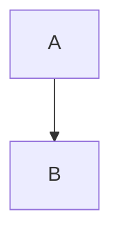

# notion-markdown 官方语法测试文档

每个 CASE 独立执行；完整文件另作整篇转换。行范围以 cases.json 为准。
元数据文首、未闭合围栏、引用定义等边界必须使用独立片段结果，不能以拼接结果替代。


<!-- CASE notion-text -->

Text {color="blue"}
	Child
		Grandchild


<!-- CASE notion-headings -->

# One
## Two
### Three
#### Four
##### Five
###### Six


<!-- CASE notion-heading-child -->

# Heading
	Child


<!-- CASE notion-lists -->

- **Bullet** {color="green"}
	Child
1. Numbered
	- Nested bullet


<!-- CASE notion-task -->

- [ ] Open {color="orange"}
	Child
- [x] Done


<!-- CASE notion-list-block -->

- 
	```python
	print(1)
	```


<!-- CASE notion-quotes -->

> First<br>Second {color="gray"}
	Child
> Separate quote


<!-- CASE notion-toggle -->

<details color="blue">
<summary>**Title**</summary>
	Child
	- Item
</details>


<!-- CASE notion-toggle-heading -->

# Heading {toggle="true" color="purple"}
	Child


<!-- CASE notion-callout -->

<callout icon="💡" color="yellow_bg">
	First **block**
	- List
		Child
</callout>


<!-- CASE notion-code -->

```python
<callout> *literal* \ $ [ ]
```


<!-- CASE notion-mermaid -->




<!-- CASE notion-equation -->

$$
\frac{1}{2}
$$


<!-- CASE notion-table -->

<table fit-page-width="true" header-row="true" header-column="true">
	<colgroup>
		<col color="blue_bg">
		<col color="yellow_bg">
	</colgroup>
	<tr color="green_bg">
		<td color="red_bg">**A**</td>
		<td>B<br>C</td>
	</tr>
	<tr>
		<td>D</td>
		<td>E</td>
	</tr>
</table>


<!-- CASE notion-table-default -->

<table>
	<tr>
		<td>text</td>
	</tr>
</table>


<!-- CASE notion-divider -->

---


<!-- CASE notion-empty -->

before

<empty-block/>

after


<!-- CASE notion-empty-inline -->

<empty-block/> trailing


<!-- CASE notion-columns -->

<columns>
	<column>
		Left
	</column>
	<column>
		Right
	</column>
</columns>


<!-- CASE notion-image -->

 {color="blue"}


<!-- CASE notion-audio -->

<audio src="https://example.com/sample" color="blue">Caption</audio>


<!-- CASE notion-video -->

<video src="https://example.com/sample" color="blue">Caption</video>


<!-- CASE notion-file -->

<file src="https://example.com/sample" color="blue">Caption</file>


<!-- CASE notion-pdf -->

<pdf src="https://example.com/sample" color="blue">Caption</pdf>


<!-- CASE notion-page -->

<page url="https://www.notion.so/11111111111111111111111111111111" color="red">Page</page>


<!-- CASE notion-database -->

<database url="https://www.notion.so/22222222222222222222222222222222" inline="true" icon="📊" color="blue">Data</database>


<!-- CASE notion-toc -->

<table_of_contents color="gray"/>

# Main
## Part


<!-- CASE notion-synced_block -->

<synced_block url="https://www.notion.so/33333333333333333333333333333333">
	Child
</synced_block>


<!-- CASE notion-synced_block_reference -->

<synced_block_reference url="https://www.notion.so/33333333333333333333333333333333">
	Child
</synced_block_reference>


<!-- CASE notion-rich-text -->

**bold** *italic* ~~deleted~~ <span underline="true">under</span> `code` [link](https://example.com) $x^2$<br>next


<!-- CASE notion-combined-span -->

<span underline="true" color="red">**marked**</span>


<!-- CASE notion-mention-user -->

<mention-user url="https://example.com/user">Name</mention-user> <mention-user url="https://example.com/user"/>


<!-- CASE notion-mention-page -->

<mention-page url="https://example.com/page">Name</mention-page> <mention-page url="https://example.com/page"/>


<!-- CASE notion-mention-database -->

<mention-database url="https://example.com/database">Name</mention-database> <mention-database url="https://example.com/database"/>


<!-- CASE notion-mention-data-source -->

<mention-data-source url="https://example.com/data-source">Name</mention-data-source> <mention-data-source url="https://example.com/data-source"/>


<!-- CASE notion-mention-agent -->

<mention-agent url="https://example.com/agent">Name</mention-agent> <mention-agent url="https://example.com/agent"/>


<!-- CASE notion-date -->

<mention-date start="2026-09-23" end="2026-09-25"/>


<!-- CASE notion-date-time -->

<mention-date start="2026-09-23" startTime="14:30" timeZone="Asia/Shanghai"/>


<!-- CASE notion-custom-emoji -->

:custom_emoji:


<!-- CASE notion-citation -->

Source[^https://example.com/reference]


<!-- CASE notion-escapes -->

\\ \* \~ \` \$ \[ \] \< \> \{ \} \| \^


<!-- CASE notion-color-gray -->

Text {color="gray"}

Background {color="gray_bg"}

<span color="gray">inline</span> <span color="gray_bg">background</span>


<!-- CASE notion-color-brown -->

Text {color="brown"}

Background {color="brown_bg"}

<span color="brown">inline</span> <span color="brown_bg">background</span>


<!-- CASE notion-color-orange -->

Text {color="orange"}

Background {color="orange_bg"}

<span color="orange">inline</span> <span color="orange_bg">background</span>


<!-- CASE notion-color-yellow -->

Text {color="yellow"}

Background {color="yellow_bg"}

<span color="yellow">inline</span> <span color="yellow_bg">background</span>


<!-- CASE notion-color-green -->

Text {color="green"}

Background {color="green_bg"}

<span color="green">inline</span> <span color="green_bg">background</span>


<!-- CASE notion-color-blue -->

Text {color="blue"}

Background {color="blue_bg"}

<span color="blue">inline</span> <span color="blue_bg">background</span>


<!-- CASE notion-color-purple -->

Text {color="purple"}

Background {color="purple_bg"}

<span color="purple">inline</span> <span color="purple_bg">background</span>


<!-- CASE notion-color-pink -->

Text {color="pink"}

Background {color="pink_bg"}

<span color="pink">inline</span> <span color="pink_bg">background</span>


<!-- CASE notion-color-red -->

Text {color="red"}

Background {color="red_bg"}

<span color="red">inline</span> <span color="red_bg">background</span>


<!-- CASE notion-pipe-table-doc-example -->

| A | B |
|---|---|
| x | y |


<!-- CASE notion-local-negative -->

<tabs>
	<tab title="Local">
		Body
	</tab>
</tabs>

<web-bookmark url="https://example.com"/>
