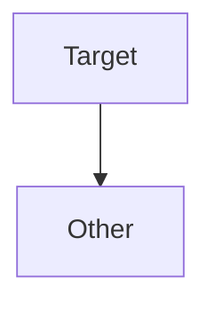

# obsidian 官方语法测试文档

每个 CASE 独立执行；完整文件另作整篇转换。行范围以 cases.json 为准。
元数据文首、未闭合围栏、引用定义等边界必须使用独立片段结果，不能以拼接结果替代。


<!-- CASE paragraphs -->

第一段 line one
line two

第二段。


<!-- CASE hard-break-spaces -->

alpha  
beta


<!-- CASE headings-atx -->

# One

## Two ##

### Three #####

#### Four

##### Five

###### Six


<!-- CASE headings-setext -->

Title
=====

Subtitle
--------


<!-- CASE headings-space-boundary -->

#nospace

####### seven


<!-- CASE heading-interruption -->

paragraph
# heading


<!-- CASE quote-lazy -->

> first line
lazy continuation
> last line


<!-- CASE quote-nesting -->

> outer
>
> > inner
>
> tail


<!-- CASE quote-blocks -->

> ## heading
>
> - item
>
>     code


<!-- CASE bullet-markers -->

* alpha
* beta

+ gamma
+ delta

- epsilon
- zeta


<!-- CASE ordered-start -->

3. third
8. fourth
1. fifth


<!-- CASE list-tight-loose -->

- tight one
- tight two

1. loose one

2. loose two


<!-- CASE list-paragraphs -->

- first

    second paragraph

    > quote

        code


<!-- CASE list-nesting -->

1. outer
    - middle
        1. inner
2. next


<!-- CASE list-interruption -->

paragraph
- candidate

1986. historical year


<!-- CASE code-indentation -->

    <sample>& literal *text*

    next line


<!-- CASE code-tab -->

	alpha	beta


<!-- CASE rules -->

***

- - -

___

* * * *


<!-- CASE inline-links -->

[label](https://example.com/a?x=1&y=2 "a title") [relative](./next.md) [fragment](#anchor)


<!-- CASE reference-links -->

[full][Ref] [ref][] [Ref]

[ref]: https://example.com "reference title"


<!-- CASE reference-spacing -->

[visible] [case fold]

[CASE FOLD]: <https://example.com>
    "continued title"


<!-- CASE reference-duplicate -->

[target]

[target]: /first
[target]: /second


<!-- CASE emphasis -->

*italic* _italic_ **bold** __bold__ ***both*** a*b*c a_b_c


<!-- CASE emphasis-boundaries -->

* spaced * ** spaced ** foo__bar__baz **outer *inner* tail**


<!-- CASE code-spans -->

`<b>& *literal*</b>` ``backtick ` inside`` `` padded ``


<!-- CASE images -->


inline ![reference][pic] tail

[pic]: /other.png "reference title"


<!-- CASE autolinks -->

<https://example.com/a?x=1&y=2> <reader@example.com>


<!-- CASE escaping -->

\*literal\* \_literal\_ \`code\` \#heading \[link] \! \\


<!-- CASE entities -->

AT&T 4 < 5 &copy; &amp; &#35; &#x41; &not-an-entity;


<!-- CASE html-inline -->

before <span title="t">*em*</span> <u>under</u> after


<!-- CASE html-block -->

before

<div>
*literal inside block*
</div>

after


<!-- CASE html-comment -->

before

<!-- hidden
line -->

after


<!-- CASE escaped-list -->

1\. plain

\- plain


<!-- CASE unicode -->

中文 **加粗** Ελληνικά café 😀


<!-- CASE table-align -->

| left | center | right |
| :--- | :---: | ---: |
| *a* | **b** | `c` |


<!-- CASE table-pipes -->

a | b
--- | ---
\| | `x\|y`
short
extra | cell | discarded


<!-- CASE table-negative -->

a | b
---
x | y


<!-- CASE table-empty-body -->

| a | b |
| --- | --- |


<!-- CASE table-block-boundary -->

| a | b |
| --- | --- |
| x | y |

> next block


<!-- CASE task-items -->

- [ ] todo
- [x] done
- [X] upper
- [a] literal
  - [ ] nested


<!-- CASE task-not-list -->

[x] plain paragraph

- [x]no following space


<!-- CASE strikethrough -->

~~deleted~~ ~single~ ~~**bold**~~

~~~triple~~~


<!-- CASE bare-autolinks -->

www.example.com https://example.com/a_(b). user@example.com foo+bar@example.org


<!-- CASE autolink-boundary -->

abcwww.example.com <https://example.com> `https://example.com` https://example.com/a&amp;


<!-- CASE tagfilter -->

<script>literal</script>

<iframe src="https://example.com"></iframe>

<xmp>raw</xmp>


<!-- CASE obs-yaml -->

---
title: Example
aliases: [Alias]
tags: [topic, project/sub]
cssclasses: [wide]
---

Body


<!-- CASE obs-styles -->

**bold** *italic* ~~deleted~~ ==marked== **_nested_**


<!-- CASE obs-comments -->

visible %% hidden inline %% tail

%%
hidden block
%%

after


<!-- CASE obs-comment-code -->

`%%literal%%`

```text
%%literal%%
```


<!-- CASE obs-wikilinks -->

[[Target]] [[Target.md]] [[Folder/Target|alias]]


<!-- CASE obs-heading-links -->

[[Target#Heading]] [[#Local]] [[Target#Parent#Child|nested]]

# Local


<!-- CASE obs-block-links -->

Paragraph ^block-id

[[#^block-id]] [[Target#^block-id|label]]


<!-- CASE obs-block-structured -->

> quote

^quote-id

[[#^quote-id]]


<!-- CASE obs-markdown-links -->

[Target](Target%20note.md) [Section](Target.md#Heading)


<!-- CASE obs-embed-note -->

![[Target]] ![[Target#Heading]] ![[Target#^block-id]]


<!-- CASE obs-embed-image -->

![[sample.svg]] ![[sample.svg|100]] ![[sample.svg|100x50]]


<!-- CASE obs-image-external -->


<!-- CASE obs-embed-audio -->

![[sample.mp3]]


<!-- CASE obs-embed-video -->

![[sample.mp4]]


<!-- CASE obs-embed-pdf -->

![[sample.pdf#page=2]] ![[sample.pdf#height=200]]


<!-- CASE obs-embed-search -->

```query
path:Target
```


<!-- CASE obs-embed-base -->

![[sample.base]]


<!-- CASE obs-table-wikilink -->

| link | image |
| -- | -- |
| [[Target\|label]] | ![[sample.svg\|80]] |


<!-- CASE obs-table-two-dashes -->

A | B
-- | --
x | y


<!-- CASE obs-footnote -->

ref[^named] and ^[inline **note**]

[^named]: first
    continued


<!-- CASE obs-math -->

$x+1$

$$
x^2
$$


<!-- CASE obs-mermaid -->




<!-- CASE obs-html -->

<div>
**not parsed in HTML**
</div>

<span>**also boundary**</span>


<!-- CASE obs-tasks -->

- [ ] open
- [x] done
- [/] non-space mark
- [-] other mark


<!-- CASE obs-tags -->

#topic #nested/topic #标签 #123


<!-- CASE obs-callout-note -->

> [!note]
> **Body**


<!-- CASE obs-callout-abstract -->

> [!abstract]
> **Body**


<!-- CASE obs-callout-summary -->

> [!summary]
> **Body**


<!-- CASE obs-callout-tldr -->

> [!tldr]
> **Body**


<!-- CASE obs-callout-info -->

> [!info]
> **Body**


<!-- CASE obs-callout-todo -->

> [!todo]
> **Body**


<!-- CASE obs-callout-tip -->

> [!tip]
> **Body**


<!-- CASE obs-callout-hint -->

> [!hint]
> **Body**


<!-- CASE obs-callout-important -->

> [!important]
> **Body**


<!-- CASE obs-callout-success -->

> [!success]
> **Body**


<!-- CASE obs-callout-check -->

> [!check]
> **Body**


<!-- CASE obs-callout-done -->

> [!done]
> **Body**


<!-- CASE obs-callout-question -->

> [!question]
> **Body**


<!-- CASE obs-callout-help -->

> [!help]
> **Body**


<!-- CASE obs-callout-faq -->

> [!faq]
> **Body**


<!-- CASE obs-callout-warning -->

> [!warning]
> **Body**


<!-- CASE obs-callout-caution -->

> [!caution]
> **Body**


<!-- CASE obs-callout-attention -->

> [!attention]
> **Body**


<!-- CASE obs-callout-failure -->

> [!failure]
> **Body**


<!-- CASE obs-callout-fail -->

> [!fail]
> **Body**


<!-- CASE obs-callout-missing -->

> [!missing]
> **Body**


<!-- CASE obs-callout-danger -->

> [!danger]
> **Body**


<!-- CASE obs-callout-error -->

> [!error]
> **Body**


<!-- CASE obs-callout-bug -->

> [!bug]
> **Body**


<!-- CASE obs-callout-example -->

> [!example]
> **Body**


<!-- CASE obs-callout-quote -->

> [!quote]
> **Body**


<!-- CASE obs-callout-cite -->

> [!cite]
> **Body**


<!-- CASE obs-callout-custom-type -->

> [!custom-type]
> **Body**


<!-- CASE obs-callout-case -->

> [!INFO] Custom *title*
> Body


<!-- CASE obs-callout-fold -->

> [!faq]- Collapsed
> Answer

> [!tip]+ Expanded
> Text


<!-- CASE obs-callout-title-only -->

> [!tip] Title only


<!-- CASE obs-callout-nesting -->

> [!question] Outer
> > [!todo] Child
> > > [!example] Deep


<!-- CASE obs-non-native -->

[toc]

{{include.md}}

```sequence
Alice->Bob: text
```
