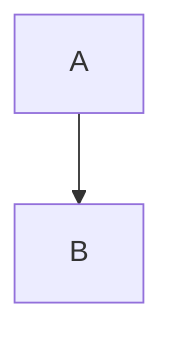

# typora 官方语法测试文档

每个 CASE 独立执行；完整文件另作整篇转换。行范围以 cases.json 为准。
元数据文首、未闭合围栏、引用定义等边界必须使用独立片段结果，不能以拼接结果替代。


<!-- CASE paragraphs -->

第一段 line one
line two

第二段。


<!-- CASE hard-break-spaces -->

alpha  
beta


<!-- CASE headings-atx -->

# One

## Two ##

### Three #####

#### Four

##### Five

###### Six


<!-- CASE headings-setext -->

Title
=====

Subtitle
--------


<!-- CASE headings-space-boundary -->

#nospace

####### seven


<!-- CASE heading-interruption -->

paragraph
# heading


<!-- CASE quote-lazy -->

> first line
lazy continuation
> last line


<!-- CASE quote-nesting -->

> outer
>
> > inner
>
> tail


<!-- CASE quote-blocks -->

> ## heading
>
> - item
>
>     code


<!-- CASE bullet-markers -->

* alpha
* beta

+ gamma
+ delta

- epsilon
- zeta


<!-- CASE ordered-start -->

3. third
8. fourth
1. fifth


<!-- CASE list-tight-loose -->

- tight one
- tight two

1. loose one

2. loose two


<!-- CASE list-paragraphs -->

- first

    second paragraph

    > quote

        code


<!-- CASE list-nesting -->

1. outer
    - middle
        1. inner
2. next


<!-- CASE list-interruption -->

paragraph
- candidate

1986. historical year


<!-- CASE code-indentation -->

    <sample>& literal *text*

    next line


<!-- CASE code-tab -->

	alpha	beta


<!-- CASE rules -->

***

- - -

___

* * * *


<!-- CASE inline-links -->

[label](https://example.com/a?x=1&y=2 "a title") [relative](./next.md) [fragment](#anchor)


<!-- CASE reference-links -->

[full][Ref] [ref][] [Ref]

[ref]: https://example.com "reference title"


<!-- CASE reference-spacing -->

[visible] [case fold]

[CASE FOLD]: <https://example.com>
    "continued title"


<!-- CASE reference-duplicate -->

[target]

[target]: /first
[target]: /second


<!-- CASE emphasis -->

*italic* _italic_ **bold** __bold__ ***both*** a*b*c a_b_c


<!-- CASE emphasis-boundaries -->

* spaced * ** spaced ** foo__bar__baz **outer *inner* tail**


<!-- CASE code-spans -->

`<b>& *literal*</b>` ``backtick ` inside`` `` padded ``


<!-- CASE images -->


inline ![reference][pic] tail

[pic]: /other.png "reference title"


<!-- CASE autolinks -->

<https://example.com/a?x=1&y=2> <reader@example.com>


<!-- CASE escaping -->

\*literal\* \_literal\_ \`code\` \#heading \[link] \! \\


<!-- CASE entities -->

AT&T 4 < 5 &copy; &amp; &#35; &#x41; &not-an-entity;


<!-- CASE html-inline -->

before <span title="t">*em*</span> <u>under</u> after


<!-- CASE html-block -->

before

<div>
*literal inside block*
</div>

after


<!-- CASE html-comment -->

before

<!-- hidden
line -->

after


<!-- CASE escaped-list -->

1\. plain

\- plain


<!-- CASE unicode -->

中文 **加粗** Ελληνικά café 😀


<!-- CASE table-align -->

| left | center | right |
| :--- | :---: | ---: |
| *a* | **b** | `c` |


<!-- CASE table-pipes -->

a | b
--- | ---
\| | `x\|y`
short
extra | cell | discarded


<!-- CASE table-negative -->

a | b
---
x | y


<!-- CASE table-empty-body -->

| a | b |
| --- | --- |


<!-- CASE table-block-boundary -->

| a | b |
| --- | --- |
| x | y |

> next block


<!-- CASE task-items -->

- [ ] todo
- [x] done
- [X] upper
- [a] literal
  - [ ] nested


<!-- CASE task-not-list -->

[x] plain paragraph

- [x]no following space


<!-- CASE strikethrough -->

~~deleted~~ ~single~ ~~**bold**~~

~~~triple~~~


<!-- CASE bare-autolinks -->

www.example.com https://example.com/a_(b). user@example.com foo+bar@example.org


<!-- CASE autolink-boundary -->

abcwww.example.com <https://example.com> `https://example.com` https://example.com/a&amp;


<!-- CASE tagfilter -->

<script>literal</script>

<iframe src="https://example.com"></iframe>

<xmp>raw</xmp>


<!-- CASE typora-yaml -->

---
title: Example
tags: [one, two]
typora-root-url: ./assets
---


<!-- CASE typora-soft-break -->

one
two

three  
four<br>five


<!-- CASE typora-toc -->

[toc]

# Main

## Child


<!-- CASE typora-footnotes -->

Here[^one] again[^one].

[^one]: A **note**.


<!-- CASE typora-block-math -->

$$
\frac{a}{b}
$$


<!-- CASE typora-inline-math -->

$x^2$ and $ spaced $


<!-- CASE typora-sub -->

H~2~O X~long\ text~


<!-- CASE typora-sup -->

X^2^


<!-- CASE typora-highlight -->

==marked==


<!-- CASE typora-emoji -->

:smile: :+1: :unknown:


<!-- CASE typora-alert-NOTE -->

> [!NOTE]
> Body


<!-- CASE typora-alert-TIP -->

> [!TIP]
> Body


<!-- CASE typora-alert-IMPORTANT -->

> [!IMPORTANT]
> Body


<!-- CASE typora-alert-WARNING -->

> [!WARNING]
> Body


<!-- CASE typora-alert-CAUTION -->

> [!CAUTION]
> Body


<!-- CASE typora-underline -->

<u>underline</u> <span style="color:red">red</span>


<!-- CASE typora-video -->

<video src="sample.mp4" controls></video>


<!-- CASE typora-iframe -->

<iframe src="https://example.com" title="Example"></iframe>


<!-- CASE typora-heading-link -->

# Target heading

[Jump](#target-heading)


<!-- CASE typora-loose-heading -->

###nospace


<!-- CASE typora-loose-list -->

1. outer
  1. inner


<!-- CASE typora-indented-code -->

    indented *text*


<!-- CASE typora-sequence -->

```sequence
Alice->Bob: Hello
```


<!-- CASE typora-flow -->

```flow
st=>start: Start
e=>end: End
st->e
```


<!-- CASE typora-mermaid -->


