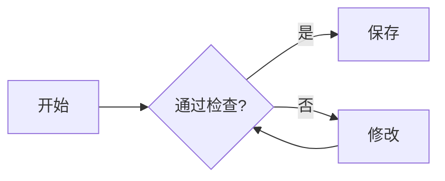
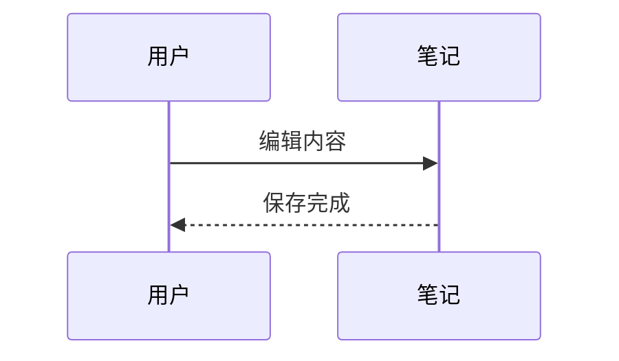

# Notdown × Obsidian 语法对照测试

这是一份手工验收输入，不是兼容性通过报告。核心范围是用户表格中第一列为 Obsidian，或最后一列包含 Obsidian 的八项：块级数学、脚注、行内数学、Mermaid、块注释、行内注释、Wikilink、Markdown 内部链接。C 组是少量基础对照；B 组用于观察异常边界，不预设所有输入都必须渲染。

## 使用方法

1. 在 Obsidian 的临时 vault 中放入本文件、同目录的 `obsidian-target note.md`、`obsidian-target-中文.md` 和 `typora-comparison-image.png`。关闭社区插件，分别观察阅读视图与实时预览；源码模式用来核对原文。
2. Notdown 使用临时知识库，新建页面，将全文粘贴到源码视图，选择 **Obsidian / obsidian** 方言。为链接测试创建标题分别为 `obsidian-target note` 和 `obsidian-target-中文` 的目标页面，并粘贴对应附件正文。记录页面 ID／实际路径；不要假定复制标题就等同于导入同名 Markdown 文件。
3. 图片在 Obsidian 按相对路径读取；Notdown 中先上传 PNG，在测试副本内替换图片地址。资源定位失败与 Markdown 解析失败分开记录。
4. 每个编号下都是实际测试语法，只有明确标为代码保护的内容使用代码围栏。不要把全文放进一个代码块。先用默认设置，再记录需要单独开启的扩展。
5. 核对显示、链接目标、编辑和保存重开。注释在阅读视图应隐藏，不等于源码可删除。数学与图表字体、配色差异单独记录。
6. 不点击“创建缺失笔记”来补齐故意缺失的目标；缺失链接用例就是测试该状态。未闭合注释放在独立文件 `obsidian-unclosed-comment.md` 中，避免吞掉主文档后续用例。

测试日期：（待填写）；Obsidian 版本：（待填写）；Notdown commit：（待填写）。

Obsidian 主题／阅读视图／实时预览设置：（待填写）；Notdown 扩展覆盖值：（待填写）。

| 编号 | Obsidian 阅读视图 | Obsidian 实时预览 | Notdown | 保存后差异／截图 |
| --- | --- | --- | --- | --- |
| 示例：O01 | 待测 | 待测 | 待测 | 待测 |

## C01 — 基础行内内容与段落

普通中文 English 123；**粗体**、*斜体*、~~删除线~~、`inline code`。

这是第二个独立段落。

软换行第一行
软换行第二行

HTML 换行第一行<br>HTML 换行第二行

## C02 — 列表与表格基础对照

- [ ] 未完成任务
- [x] 已完成任务
- 普通列表项

列表后独立段落，应与列表有可辨认的间距。

| 左列 | 右列 |
| :--- | ---: |
| **粗体** | `code` |
| 第一行<br>第二行 |  |

观察单元格内换行、空单元格、文字可编辑性。不要将表格单元格当作任意块容器。

## C03 — 普通链接与图片

[普通外链](https://example.com/)，[引用式外链][external-probe]，<https://example.com/>。


[external-probe]: https://example.com/reference "引用目标"

## O01 — 块级数学

$$
y=x^2
$$

两个公式之间的普通段落，不应被公式吞掉。

$$
\begin{aligned}
a^2+b^2 &= c^2 \\
\sum_{k=1}^{n} k &= \frac{n(n+1)}{2}
\end{aligned}
$$

公式后的普通文字。观察公式是否居中、尺寸是否可读，以及是否能编辑公式源码。

## O02 — 行内数学

前文 $y=x^2$ 后文；中文紧邻$x+1$中文；分式 $\frac{a}{b}$ 与根式 $\sqrt{2}$。

同一段两个公式：$a+b$ 和 $c+d$。

边界观察：价格 $5 和 $10；转义美元 \$20；代码 `$y=x^2$`。逐项记录是否被误识别成公式。

## O03 — 脚注

这是第一个脚注引用[^fn1]，重复引用同一个脚注[^fn1]，再引用多段脚注[^long-note]。

[^fn1]: text in *footnote*；保留中文与 **bold**。

[^long-note]: 第一段，含 [外部链接](https://example.com/footnote) 和 `code`。

    第二段，观察是否仍属于同一个脚注。

这里是定义之后的正文，不应变成脚注内容。记录脚注展示位置、编号、重复引用、点击跳转和返回行为；脚注源标签不等同于展示编号。

## O04 — Mermaid 流程图与时序图



两张图之间的正文。



观察渲染成功与否、居中、尺寸、源码编辑和保存重开。空围栏只作为边界探针，不要求生成某一种占位图：

```mermaid
```

## O05 — 块注释

BLOCK-COMMENT-BEFORE：这段应可见。

%%
BLOCK-COMMENT-HIDDEN
这里包含 **粗体标记**、[[obsidian-target note]] 和 $x^2$。

这里还有一个空行后的注释段落。
%%

BLOCK-COMMENT-AFTER：这段应可见。阅读视图中前后哨兵仍在，中间注释不显示；保存后源码中的注释内容仍应保留。

## O06 — 行内注释

VISIBLE-LEFT%%INLINE-COMMENT-HIDDEN%%VISIBLE-RIGHT

第一处 %%隐藏 A%% 中间可见 %%隐藏 B%% 最后可见。

注释旁边的 **粗体** %%隐藏内容%% 和 [外链](https://example.com/)。

观察阅读视图隐藏范围；编辑模式如何显示注释单独记录。不能因为注释隐藏就连同前后文字一起隐藏。

## O07 — Wikilink 内部链接

[[obsidian-target note]]

[[obsidian-target note|自定义显示文字]]

[[obsidian-target-中文]]

[[obsidian-target note#Target heading]]

[[#本页锚点]]

[[obsidian-missing-target-probe]]

前五项测试现有目标／标题跳转；最后一项故意不存在。分别记录可见标签、链接样式、实际跳转目标和缺失状态。目标页面标题、真实文件路径与 Notdown 页面 ID 的映射问题单独记录。

### 本页锚点

LOCAL-ANCHOR-TARGET：页内链接应定位到这里。

## O08 — Markdown 格式的内部链接

[英文空格文件名](obsidian-target%20note.md)

[自定义标签，指向同一文件](obsidian-target%20note.md)

[中文文件名](obsidian-target-中文.md)

[文件内标题](obsidian-target%20note.md#Target%20heading)

[故意缺失的文件](obsidian-missing-target-probe.md)

这种写法的链接语法本身属于普通 Markdown；这里额外测试的是应用把 `.md` 地址解析为知识库内部笔记的行为。比较它与 O07 是否到达同一个现有目标，不把“有链接样式”当成“跳转正确”。

## B01 — 代码保护

行内代码应保留标记：`%%comment%%`、`[[obsidian-target note]]`、`$y=x^2$`、`text[^fn1]`。

````markdown
%% comment must remain visible in code %%
[[obsidian-target note]]
[note](obsidian-target%20note.md)
$$
y=x^2
$$
```mermaid
flowchart LR
  A --> B
```
````

B01-AFTER：代码围栏之外的文字仍应正常显示。

## B02 — 未定义与未闭合行内语法

text[^missing-footnote-probe]

[[unfinished-wikilink

unclosed math $x+1

B02-AFTER：记录每项是字面文字、链接、错误提示还是其他形式；保存后不能静默丢失源码。未闭合块注释请另开附带文件测试。

## R01 — 编辑与保存往返

将本句的 EDIT-ME 改成 EDITED，再保存、关闭并重新打开。

1. 确认 O05/O06 的隐藏注释仍存在于源码。
2. 编辑 C02 单元格的“第二行”，应直接编辑文字，不应选中一个不可编辑的 HTML 整体。
3. 修改 O01 一个变量与 O04 一个节点标签，确认修改可以保存并重新渲染。
4. 确认 Wikilink 的别名、空格文件名、脚注标签、未知语法和未修改的代码围栏没有因无关编辑丢失。
5. 跨应用保存后的格式归一化与内容丢失分开记录，不要求两个编辑器写出逐字相同的排版。

END-OF-OBSIDIAN-COMPARISON：正文结束哨兵。脚注可以显示在此后，但主正文不应被未闭合语法意外吞掉。

## 参考范围

用户表格为本样本的范围来源；官方说明用于核对术语与正常语法，不代表 Notdown 已通过对应功能。

- [Obsidian 基础语法：脚注、注释与链接](https://obsidian.md/help/syntax)
- [Obsidian 高级语法：数学与 Mermaid](https://obsidian.md/help/advanced-syntax)
- [Obsidian 内部链接](https://obsidian.md/help/links)

本文件没有将未在用户清单中标为 Obsidian 的所有 Typora 项目自动纳入，也不覆盖完整 Obsidian 语法或社区插件。
