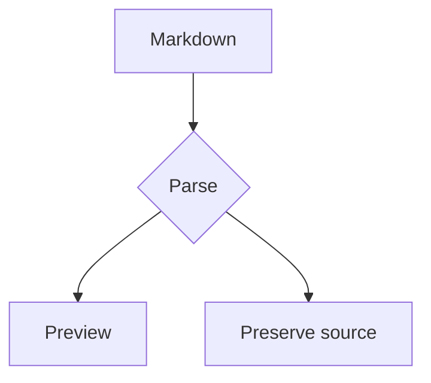
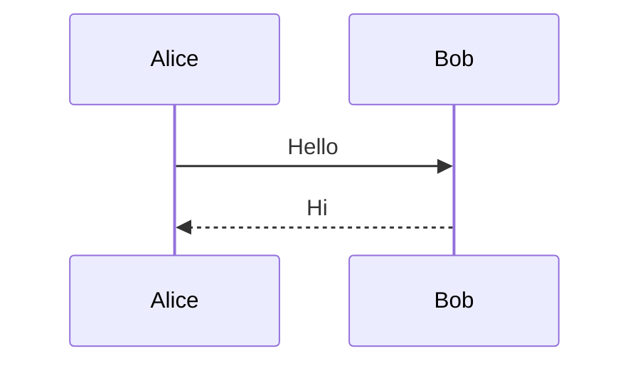

# Notdown × Typora 语法对照测试

这是一份手工验收样本，不是已经通过的兼容性报告。样例来源：用户整理的 Markdown / CommonMark / GFM 清单及 18 项 Typora 扩展。每个编号后的内容都是实际测试输入；代码保护测试除外，不要将全文包在代码围栏里。

## 使用方法与记录

1. 保留本文件原件，分别使用副本测试。Typora 直接打开 `.md`；Notdown 在临时知识库中新建页面，将本文件全文粘贴到**源码视图**，选择 **Typora / typora** 方言，再切换到页面视图。不要在 Notion 默认方言或 Markdown Lab 的 Pandoc reader 中代测。
2. 文件最前面的 YAML 是测试正文的一部分。粘贴时也要包含它，不要把它合并到 Notdown 知识库文件外层的页面 YAML 中。
3. 记录两个应用的版本、Notdown 扩展开关、Typora Markdown 偏好设置、Strict Mode 状态和主题。先测默认设置，再对数学、上下标、高亮等选项做启用/停用对照；每轮都记录设置。
4. 比较语义、层级、链接目标、换行和源码保留；字体、颜色、公式字体不同单独记录，不直接算解析错误。未渲染、未启用、资源加载失败、原文丢失应分别记录。
5. 对 B01–B03 分别测试 Strict Mode 开/关。单个文件无法同时代表两种模式的结果。
6. 保存并重新打开；对 R01 做编辑往返测试。未闭合围栏放在文件最后，避免吞掉其余测试。

测试日期：（待填写）；Typora 版本：（待填写）；Notdown commit：（待填写）。

Typora 偏好设置 / Strict Mode：（待填写）；Notdown 方言 / 扩展覆盖值：（待填写）。

| 用例编号 | Typora 实测 | Notdown 实测 | 保存后源码差异 | 结论 / 截图编号 |
| --- | --- | --- | --- | --- |
| 示例：T08 | 待测 | 待测 | 待测 | 待测 |

## C01 — ATX 标题与闭合标记

观察六级标题及闭合 `#` 是否被当作标题标记。

# header 1

## header 2

### header 3

#### header 4

##### header 5

###### header 6

### header 3 with closing hashes #####

## C02 — Setext 标题

Setext level one
===

Setext level two
---

## C03 — 四种分隔线

下面依次为星号带空格、连续星号、连字符、下划线。

* * *

***

---

______

## C04 — 段落、空行、软换行与硬换行

单换行在 CommonMark 默认合并为空格；Typora 编辑视图默认保留换行，且可通过偏好设置改变。Notdown Typora 与 Obsidian 预设默认开启 `hard_line_breaks`，关闭后按合并空格的行为对照。Typora 顶层段落之间多余空行显示为可编辑空段落；检查点击输入、删除、撤销及保存后源码的保留情况。

软换行第一行
软换行第二行

新段落，与前段之间有一个空行。


此段之前有三个空行；观察保存后空行是否保留。

两个尾随空格产生的硬换行第一行  
硬换行第二行

反斜杠硬换行第一行\
硬换行第二行

HTML 换行第一行<br>HTML 换行第二行

## C05 — 三种代码块

缩进代码，第一行有四个空格：

    code line
        code line
    code line

```javascript
const literal = "**不是加粗** $不是公式$ [toc]";
    console.log(literal);

// 空行与缩进应保留
```

~~~python
value = "==不是高亮=="
    # 保留缩进；仅测试显示，不执行代码
~~~

## C06 — 引用、惰性续行与嵌套

> blockquote
>
> ## h2 in a blockquote
> 1. list item
>
>         code block

引用惰性续行：

> blockquote
blockquote lazy continuation

嵌套引用：

> outer blockquote
>
> > nested blockquote

## C07 — 无序列表三种标记

* star item one
* star item two

分隔文字。

+ plus item one
+ plus item two

分隔文字。

- minus item one
- minus item two

## C08 — 有序列表编号与右括号

1. item one
2. item two
3. item three

以下源码编号都为 1，观察显示编号与保存源码。

1. repeated one
1. repeated two
1. repeated three

以下源码编号为 3、1、8，观察起始值和连续编号。

3. starts at three
1. source number one
8. source number eight

右括号标记（CommonMark/GFM 正向用例；按用户实测，Typora 为不应生成列表的反向用例）：

1) right parenthesis one
2) right parenthesis two
3) right parenthesis three

## C09 — 列表嵌套、续行与复合内容

续行仍属于同一个列表项；是否显示换行另受换行设置影响。不要把「同一项」与「同一视觉行」混为一谈。

* parent one
    1. child one
    2. child two
* parent two

显式缩进续行：

*   word word
    word

惰性续行：

* word word
word

同项内多段落：

*   item

    second paragraph in same item

同项内引用和缩进代码：

*   item

    > block quote

        code block

## C10 — 行内代码、强调与组合

text `code` text；text ``code with ` in it`` text。

*emphasis*；_emphasis_；**strong emphasis**；__strong emphasis__。

***strong and emphasis***；**bold with *italic* inside**；foo_bar_baz。

## C11 — 普通链接与引用链接

检查链接外观、目标地址与打开行为。Notdown 编辑区使用 Ctrl/⌘ + 点击打开外部链接，普通点击用于定位和编辑文字。

[inline link](https://example.com/)；[link with title](https://example.com/ "title")。

[double-quote title][ref-double]；[single-quote title][ref-single]；[parenthesis title][ref-paren]；[next-line title][ref-next]。

[named reference][ref-name]；[collapsed][]；[shortcut]。

[ref-double]: https://example.com/double "double title"
[ref-single]: https://example.com/single 'single title'
[ref-paren]: https://example.com/paren (parenthesis title)
[ref-next]: https://example.com/next
    "next line title"
[ref-name]: https://example.com/named
[collapsed]: https://example.com/collapsed
[shortcut]: https://example.com/shortcut "shortcut title"

## C12 — 图片与引用式图片

两张图引用同一个随附本地 PNG。Typora 从当前目录解析；在 Notdown 中需将随附图片上传到临时知识库，并在测试副本中把两处路径改为上传返回的路径。仅粘贴 Markdown 不会自动导入图片。分别记录资源路径问题与 Markdown 解析问题。


![引用式 ND 测试图片][image-ref]

[image-ref]: typora-comparison-image.png "reference image title"

## C13 — 自动链接

<https://example.com/>

<address@example.com>

www.commonmark.com

http://example.com

address@example.com

mailto:address@example.com

边界：括号内 (https://example.com/path)，句末 https://example.com/end. 观察标点是否被包含进链接。

## C14 — HTML 块与行内 HTML

paragraph before HTML

<table>
    <tr>
        <td>HTML cell one</td>
        <td>HTML cell two</td>
    </tr>
</table>

paragraph after HTML

text <del>deleted HTML text</del> text；<kbd>Ctrl</kbd>；H<sub>2</sub>O；X<sup>2</sup>。

## C15 — 反斜杠转义、实体与普通文本

用户提供的 Typora 实测：第二行的双引号、百分号、&、单引号、逗号、斜杠、冒号、分号、问号和 @ 前保留反斜杠；美元符号、尖括号、等号、上箭头、竖线、波浪线前去掉反斜杠。Notdown Typora 默认按此范围识别；显式开启 `all_symbols_escapable` 后采用所有 ASCII 标点可转义的行为。代码内容仍保持字面值。

\\ \` \* \_ \{ \} \[ \] \( \) \# \+ \- \. \!

\" \$ \% \& \' \, \/ \: \; \< \> \= \? \@ \^ \| \~

&copy; &amp; &lt; &gt; &#65; &#x4E2D;

hello $.;'there；中文 English 123；普通文本应完整保留。

## G01 — GFM 管道表格

| col one | col two |
| --- | --- |
| foo | bar |

| 左对齐 | 居中 | 右对齐 |
| :--- | :---: | ---: |
| **bold** | `code` | 123 |
| [link](https://example.com/) | a\|b | 456 |
| 空单元格 → | | 789 |
| 第一行<br>第二行 | `x\|y` | ~~deleted~~ |

## G02 — 任务列表

- [ ] unchecked
- [x] checked lowercase
- [X] checked uppercase
- [ ] parent task
  - [x] child task
  - [ ] another child

以下是 GFM 有序任务列表扩展用例。用户提供的 Typora 实测为普通有序列表，保留 `[ ]` / `[x]` 文字，不生成复选框；Notdown Typora 方言应与此一致。cmark-gfm 生成复选框，Pandoc 3.11 的 gfm reader 保留文字。GitHub 官方 Markdown 速查表第 2 页 TASK LISTS 注明 “any unordered or ordered list supported”：https://enterprise.github.com/downloads/en/markdown-cheatsheet.pdf 。规范依据为 GFM §5.2 的列表项定义及 §5.3 的任务列表项规则；§5.3 未单独展示有序任务示例。

1. [ ] ordered task
2. [x] ordered completed task

## G03 — 删除线及边界

~~strikethrough~~；~~**bold deleted**~~；~single tilde probe~。

最后一个是单波浪线边界，与 Typora 下标设置一起观察，不能混同双波浪线删除线。

## G04 — HTML 过滤差异探针

Notdown 当前策略：`script`、`style` 不生成预览内容，保持空白；`textarea` 显示只读文本框，内容通过“编辑 HTML”修改保存。单行 `xmp`、`noembed` 属于行内 HTML，只显示里面的文字，不显示标签原文，Typora 方言也一样。块级 HTML 可展开源码，行内 HTML 在源码视图编辑。这是 Notdown 的显示约定，不承诺复刻 Typora 的全部 HTML 行为。

下面是实际 HTML 输入。仅记录各标签是否显示、被转义、被过滤，以及保存后是否保留；本文件不预设两个应用必须执行相同的 HTML 策略。iframe 在 T12 单独测试。以下 script 仅含非执行数据。

<title>PROBE title text</title>

<textarea>PROBE textarea text</textarea>

<style>/* PROBE style: no CSS rules */</style>

<xmp>PROBE xmp text</xmp>

<noembed>PROBE noembed text</noembed>

<noframes>PROBE noframes text</noframes>

<script type="application/json">{"probe":"inert-data"}</script>

G04 后置哨兵：此文字必须仍可恢复。

## T01 — 块级数学公式

$$
y=x^2
$$

$$
\begin{aligned}
a^2+b^2 &= c^2 \\
\int_0^1 x^2\,dx &= \frac{1}{3}
\end{aligned}
$$

## T02 — 脚注

text[^fn1]；重复引用同一个脚注[^fn1]；另一个多段脚注[^long-note]。

[^fn1]: text in *footnote*

[^long-note]: 第一段，包含 **bold** 和 [link](https://example.com/)。

    第二段，观察是否仍属于脚注。

观察脚注引用、定义位置、编号、跳转及重复引用；这些行为分别记录。

## T03 — YAML front matter

实际输入位于文件最开头，以 `layout: post`、`title`、列表和嵌套未知字段构成。观察是否显示为元数据、是否误认成分隔线，以及保存后 `custom_probe` 是否保留。

## T04 — 目录

[toc]

观察目录是否生成、各级标题是否出现、点击是否跳转；代码围栏里的假标题不得进入目录。新增标题后再观察目录更新。

## T05 — GitHub 风格提示块

> [!NOTE]
> text，包含 **bold**。
> > text

> [!TIP]
> A helpful tip.

> [!IMPORTANT]
> Important information.

> [!WARNING]
> Warning information.

> [!CAUTION]
> Caution information.

## T06 — 页内链接与标题 ID

[跳到 Header 3](#header-3)；[跳到中文标题](#中文锚点测试)；[跳到不存在的标题](#missing-header-probe)。

第一个链接指向 C01 的 `header 3`；中文和不存在的目标作为边界测试。

### 中文锚点测试

中文锚点目标。

## T07 — Emoji

:smile: :heart: :+1: :not_a_real_emoji_probe: 😄

观察已知短码、未知短码和原生 Unicode Emoji；未知短码应可恢复。

## T08 — 行内数学与美元符号边界

行内公式 $y=x^2$；含分式 $\frac{a}{b}$；中文前$x+1$中文后。

价格 $5 和 $10；转义美元 \$20；未闭合 $x+1。

边界探针 $ x + 1 $ 与代码 `$y=x^2$`；记录实际解释，不预设全部都是数学。

## T09 — 下标

H~2~O；CO~2~；a~i~；转义 H\~2\~O；代码 `H~2~O`。

## T10 — 上标

X^2^；x^n+1^；转义 X\^2\^；代码 `X^2^`。

## T11 — 高亮

==highlight==；==**bold highlight**==；中文==重点==中文；转义 \=\=literal\=\=；代码 `==highlight==`。

## T12 — iframe 嵌入

此项需要网络。远端拒绝嵌入或网络错误应记为资源问题；另记录解析器是否识别 iframe、是否保留属性和原文。使用原始 HTML URL，不能把 Markdown 链接语法塞进 src。

<iframe height="265" scrolling="no" title="Fancy Animated SVG Menu" src="https://codepen.io/jeangontijo/embed/OxVywj/?height=265&amp;theme-id=0&amp;default-tab=css,result&amp;embed-version=2" frameborder="no" allowtransparency="true" allowfullscreen="true" style="width: 100%;"></iframe>

## T13 — sequence 图表

```sequence
Alice->Bob: Hello Bob
Bob-->Alice: Hello Alice
```

空图表边界：

```sequence
```

## T14 — flow 图表

```flow
st=>start: Start
op=>operation: Read markdown
cond=>condition: Valid?
e=>end: End
st->op->cond
cond(yes)->e
cond(no)->op
```

空图表边界：

```flow
```

## T15 — Mermaid





空图表边界：

```mermaid
```

## B01 / T16 — 非严格标题

下面第一行 `#` 后没有空格；第二行有空格。Notdown 对应 `space_in_atx_header` 开关，分别比较开关前后行为。

###header

### header with required space

## B02 / T17 — 非严格列表续行

下面第二行恰好有两个 ASCII 空格：

1. word
  word

对照：第二行四个空格。

1. word
    word

## B03 / T18 — 非严格嵌套列表

子列表前恰好两个 ASCII 空格：

1. item
  1. item

对照：子列表前四个空格。

1. item
    1. item

Notdown 的 B02/B03 对应 `typora_loose_lists`；记录是否嵌套、是否变成同级列表、保存后缩进是否改变。

## B04 — 代码与转义保护

以下围栏中的内容全部应作为代码文字保留，不得生成目录、图表、公式、脚注或提示块。

````markdown
---
title: not metadata
---
# FAKE HEADING INSIDE CODE
[toc]
> [!NOTE]
- [x] not a task
$$
y=x^2
$$
text[^fake]
[^fake]: not a footnote
:smile: H~2~O X^2^ ==highlight==
<iframe src="https://example.com/"></iframe>
```mermaid
graph TD
    X --> Y
```
````

\*literal emphasis\*；\[toc\]；\$y=x^2\$；\~\~literal strike\~\~。

## B05 — 未知及未闭合行内语法

[undefined reference][missing-ref-probe]

text[^missing-footnote-probe]

==unclosed highlight

**unclosed strong

<unknown-probe data-keep="yes">未知标签内容 KEEP-UNKNOWN</unknown-probe>

B05 后置哨兵：未识别语法与相邻正文均不得丢失。

## R01 — 编辑与源码往返检查

EDIT-ME：只将本段中的 apple 改为 orange。

1. 先不编辑，只切换「源码 → 页面 → 源码」，比较整个正文是否变化。
2. 仅修改上面的 apple，再保存并重新打开。比较其他顶层块，重点检查 YAML 未知字段、引用定义、代码围栏、HTML 属性、图表源码和连续空行。
3. 在副本中切换任务复选框；修改表格单元格；修改公式；修改图表源码。每次单独保存，检查改动范围与重新解析结果。
4. 在 Typora 的独立副本上做相同操作，记录它的源码规范化行为；不要让两个应用并发改同一份文件。
5. 对未实现或未识别的内容，分别记录「原文可恢复」和「原文丢失」，不要只依据预览判定。

## B06 — plaintext 与文件末尾隔离测试

HTML `plaintext` 可能让后续内容全部成为字面文本，因此只在此展示转义形式：`<plaintext>PROBE plaintext text`。要测实际标签，请在另一份空白测试页粘贴该代码内容；本项不计作已在全文中执行的用例。

## B07 — 未闭合围栏（必须保持在文件最后）

从下一行开始直至 EOF 都属于未闭合围栏探针。观察是否保留为代码、是否报错，以及保存是否补齐围栏。其内假标题不得成为正常标题。

```markdown
# EOF FAKE HEADING
[toc]
$$
y=x^2
EOF-SENTINEL：此行及前面的所有原文必须可恢复。
